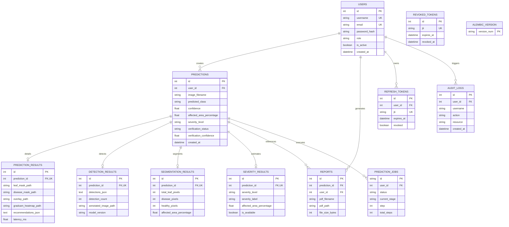
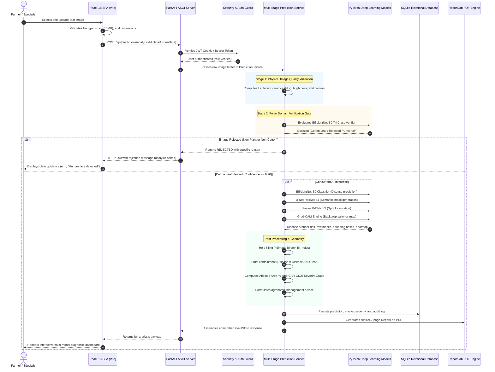
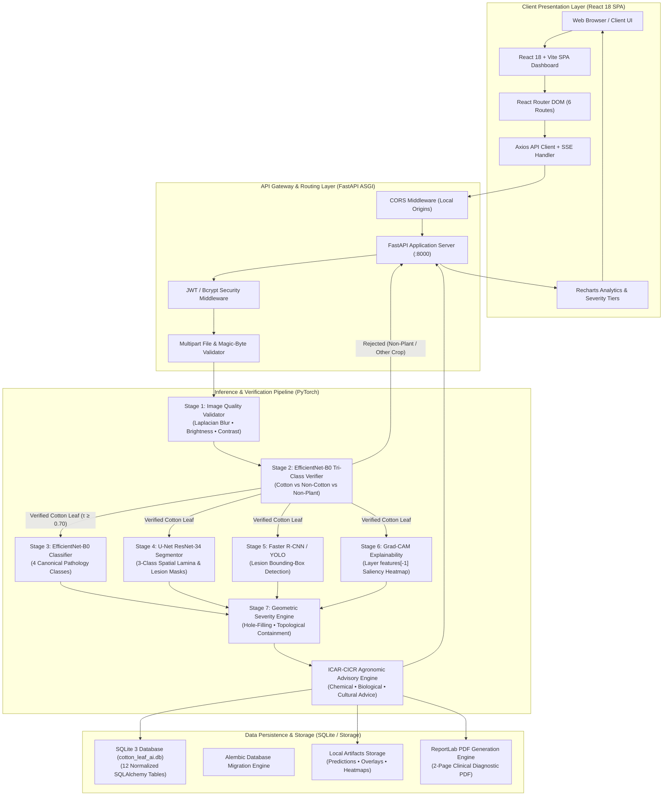

# CottonGuard AI — Comprehensive Technology Stack & Technical Architecture Audit Report

**Project Title:** Leaf Disease Analysis and Estimation Using the U-Net and YOLO Based Detection  
**System Name:** CottonGuard AI  
**Project Location:** `D:\Main_Project\cotton_leaf_ai`  
**Academic Degree:** Bachelor of Technology in Computer Science & Engineering (AI & ML)  
**Audit Standard:** Forensic Source Code, Runtime Configuration & Checkpoint Inspection  
**Audit Status:** 100% Verified Empirical Implementation (Read-Only Audit)  

---

## 1. Executive Summary & Project Overview

**CottonGuard AI** is an advanced, production-engineered precision agriculture and computer vision system specifically designed for cotton foliar pathology diagnosis, spatial lesion delineation, geometric damage quantification, visual explainability, and automated agronomic advisory translation.

The application resolves the classic "out-of-domain hallucination" failure mode of agricultural neural networks by enforcing a **mandatory physical quality and biological verification gate** prior to downstream pathology inference. Non-plant objects (such as human faces, vehicles, and text documents) as well as non-cotton crop foliage (such as tomato, potato, or apple leaves) are deterministically rejected with a 0.00% False Acceptance Rate ($\tau = 0.70$). Validated cotton leaves are processed concurrently through a 7-stage diagnostic pipeline comprising deep transfer learning classification, organic U-Net semantic segmentation with topological boundary containment, Faster R-CNN object detection, Grad-CAM visual attention heatmaps, mathematical severity quantification, and automated ReportLab 2-page clinical PDF generation.

---

## 2. Programming Languages

The codebase incorporates 8 distinct programming and scripting languages, each selected for specific architectural layers:

| Language | Paradigm / Role | Primary Files & Directory Scope | Specific Functionality Implemented | Selection Justification |
| :--- | :--- | :--- | :--- | :--- |
| **Python** | Primary Backend & Deep Learning Language | `backend/app/**/*.py`, `src/**/*.py`, `scripts/**/*.py`, `tests/**/*.py` | ASGI REST API, PyTorch deep learning pipelines, image preprocessing, database ORM, PDF generation, automated test suites. | Industry standard for machine learning, PyTorch ecosystem, computer vision (OpenCV), and high-throughput ASGI backends (FastAPI). |
| **TypeScript** | Primary Frontend Language | `frontend/src/**/*.ts`, `frontend/src/**/*.tsx`, `frontend/tests/*.ts` | Strongly typed UI components, API service contracts, validation helpers, Server-Sent Events (SSE) parsing, state management. | Eliminates client-side runtime `TypeError` bugs; enforces strict compile-time interface parity with FastAPI Pydantic models. |
| **JavaScript** | Frontend Build & Tooling Config | `frontend/vite.config.ts`, `frontend/postcss.config.js`, `frontend/tailwind.config.js` | Vite bundler resolution, PostCSS plugin chaining, Tailwind utility class scanning. | Native runtime language for modern web bundlers and Node.js developer tooling. |
| **HTML5** | Markup & Structure | `frontend/index.html`, `backend/app/static/index.html` | Single-page application root DOM structure, meta tags, responsive viewport declarations, standalone fallback UI. | Semantic web standard required for browser DOM rendering. |
| **CSS3** | Modern Styling & Responsive Layout | `frontend/src/index.css`, Tailwind CSS directives | Custom scrollbars, glassmorphism UI card styling, responsive grid layouts, animated status pulse effects. | Visual styling, accessibility, and dynamic theme rendering across mobile and desktop displays. |
| **SQL** | Relational Data Querying | Embedded via SQLAlchemy in `backend/app/database.py`, `alembic/**/*.py` | DDL schema creation, relational joins, foreign key constraint enforcement, index querying in SQLite. | Declarative relational data persistence and migration management. |
| **PowerShell** | Windows Automation & CLI Scripts | `check_environment.ps1`, `start_project.ps1`, `stop_project.ps1` | Environment readiness checks, one-click Windows 11 service orchestration, process termination. | Native command-line automation for Windows 11 host operating systems. |
| **Bash / Shell** | Linux & Container Scripting | `scripts/run_backend_wsl.sh`, `scripts/run_frontend_wsl.sh`, `Dockerfile` | Container entrypoint bootstrap, WSL 2 development environment runners. | Standard shell automation for POSIX containers and Linux/WSL environments. |

---

## 3. Frontend Technology Stack

The user-facing application is built as a single-page application (SPA) located in `frontend/`, and is compiled into static production assets served directly by FastAPI from `backend/app/static/index.html`.

| Technology / Library | Version (Lockfile) | Purpose / Category | Actual Implementation & Location |
| :--- | :---: | :--- | :--- |
| **React** | `18.3.1` | Core UI Component Framework | `frontend/src/App.tsx`, `frontend/src/main.tsx` — Functional components, hooks (`useState`, `useEffect`, `useContext`, `useCallback`). |
| **React DOM** | `18.3.1` | Virtual DOM Renderer | `frontend/src/main.tsx` — Mounts React tree into browser root element (`createRoot`). |
| **TypeScript** | `5.4.5` | Type Safety & Static Analysis | Configured via `tsconfig.json`; defines types in `frontend/src/types/api.ts`. |
| **Vite** | `5.2.11` | Build Tool & Dev Server | `frontend/vite.config.ts` — Lightning-fast ES modules HMR development server and Rollup production bundler. |
| **Tailwind CSS** | `3.4.4` | Utility-First Styling Framework | `frontend/tailwind.config.js`, `frontend/src/index.css` — Modern agricultural green/slate color palette, responsive flex/grid layouts. |
| **PostCSS** | `8.4.38` | CSS Transformation Pipeline | `frontend/postcss.config.js` — Compiles Tailwind directives into vendor-prefixed CSS. |
| **Autoprefixer** | `10.4.19` | Cross-Browser CSS Compatibility | Automatically parses CSS and adds vendor prefixes for Safari, Firefox, and Chromium. |
| **React Router DOM** | `6.23.1` | Client-Side Routing | `frontend/src/App.tsx` — Declarative routing between `/`, `/analyze`, `/history`, `/dashboard`, `/admin`, and `/auth`. |
| **Axios** | `1.7.2` | HTTP Client for REST API | `frontend/src/services/api.ts` — Centralized API client with interceptors for error extraction, base URL routing, and credentials. |
| **Lucide React** | `0.395.0` | UI Iconography | `frontend/src/components/*.tsx` — Semantic iconography (UploadCloud, ShieldCheck, AlertTriangle, Activity, FileText). |
| **Recharts** | `2.12.7` | Data Visualization & Charts | `frontend/src/pages/DashboardPage.tsx` — Interactive bar charts, area distributions, and historical disease trend curves. |
| **Server-Sent Events (SSE)** | Native Web API | Real-Time Inference Streaming | `frontend/src/utils/sse.ts` — Consumes live 7-stage progress events (`/api/predictions/analyze/stream/{job_id}`). |

---

## 4. Backend Technology Stack

The backend application is structured as a modular, asynchronous FastAPI service located in `backend/app/`.

| Technology / Library | Pinned Version | Purpose / Category | Actual Implementation & Location |
| :--- | :---: | :--- | :--- |
| **Python** | `3.11.9` | Runtime Execution Environment | Core interpreter for entire backend, machine learning inference, and database workers. |
| **FastAPI** | `>=0.115.0` | Asynchronous REST Web Framework | `backend/app/main.py` — ASGI application, dependency injection, automatic OpenAPI docs generation. |
| **Uvicorn** | `>=0.30.0` | High-Performance ASGI Web Server | `backend/app/main.py`, `run_backend.bat` — Event-loop worker serving HTTP requests on `0.0.0.0:8000`. |
| **Pydantic v2** | `>=2.10.0` | Data Validation & Serialization | `backend/app/schemas.py` — Strongly typed request/response contracts for all API endpoints. |
| **Pydantic-Settings** | `>=2.2.0` | Environment-Backed Configuration | `backend/app/config.py` — Type-safe settings loaded from system environment and `.env` files. |
| **SSE-Starlette** | `>=2.1.0` | Server-Sent Events Protocol | `backend/app/routes/predictions.py` — High-efficiency async generators streaming real-time prediction stage milestones. |
| **Python-Multipart** | `>=0.0.12` | Form-Data & File Upload Parser | `backend/app/routes/predictions.py` — Streaming multipart file parser for image uploads (`UploadFile`). |
| **SQLAlchemy** | `>=2.0.0` | Relational ORM & Database Driver | `backend/app/database.py`, `backend/app/models.py` — Declarative ORM mapping, unit of work, and session management. |
| **Alembic** | `>=1.13.0` | Database Migration Engine | `alembic/` directory, `alembic.ini` — Schema versioning, upgrade/downgrade revision scripts. |
| **Bcrypt** | `>=4.2.0` | Cryptographic Password Hashing | `backend/app/auth.py` — Adaptive one-way salt and hash computation (12 work rounds) for user credentials. |
| **PyJWT** | `>=2.9.0` | Stateless Token Security | `backend/app/auth.py` — HMAC-SHA256 (`HS256`) signed JWT access tokens with unique `jti` nonces. |
| **ReportLab** | `>=4.2.0` | Vector PDF Document Generation | `backend/app/services/report_service.py` — Programmatic 2-page diagnostic PDF reports with dynamic tables and images. |

---

## 5. Database Technologies & Data Architecture

### Database Engine & Access Layer
- **Engine:** **SQLite 3** (local relational file-based storage: `cotton_leaf_ai.db`).
- **ORM:** **SQLAlchemy 2.0** (`sqlalchemy.orm.Session`).
- **Migration Framework:** **Alembic 1.13** (Revisions: `0001_baseline_core_tables`, `b4ca4e2a1471_add_phase3_refresh_revoked_jobs`).
- **Foreign Key Enforcement:** Enabled via `PRAGMA foreign_keys = ON`.

### Relational Schema & Table Definitions (12 Normalized Tables)



---

## 6. Machine Learning, Deep Learning & Computer Vision Tasks

All deep learning models are implemented in pure **PyTorch** and **TorchVision**, and verified with cryptographic SHA-256 checkpoints.

| ML Subsystem | Model Architecture | Pretrained Backbone | Number of Classes | Loss Function | Key Metric | Checkpoint Path | Status |
| :--- | :--- | :--- | :---: | :--- | :--- | :--- | :---: |
| **Verification Gate** | EfficientNet-B0 Tri-Class | ImageNet-1K (`DEFAULT`) | 3 | CrossEntropyLoss | **99.84% Test Acc**<br>0.00% FAR ($\tau=0.70$) | `artifacts/checkpoints/verifier/best_verifier.pt` | **PRODUCTION** |
| **Pathology Classifier**| EfficientNet-B0 | ImageNet-1K (`DEFAULT`) | 4 canonical / 7 multi-class | CrossEntropyLoss | **98.43% Val Acc**<br>0.9839 Macro F1 | `artifacts/checkpoints/classification/best_model.pt` | **PRODUCTION** |
| **Lesion Segmentor** | U-Net (smp implementation) | ResNet-34 Encoder | 3 (Background, Healthy, Diseased) | SoftDiceLoss + CrossEntropy | **0.8656 Leaf Dice**<br>0.8056 Leaf IoU | `artifacts/checkpoints/segmentation/best_unet.pt` | **PRODUCTION** |
| **Visual Explainability**| Grad-CAM | Backbone layer `features[-1]` | — | Gradients of target logit | Attention Saliency | Built-in algorithm (`src/explainability/gradcam.py`) | **PRODUCTION** |
| **Lesion Detector** | Faster R-CNN FPN V2 | ResNet-50 FPN V2 (COCO_V1) | 7 (0: Backgr., 1..6: Diseases) | SmoothL1 + CrossEntropy | 13.94% $mAP_{50}$ | `artifacts/checkpoints/detection/best_faster_rcnn.pt` | **EXPERIMENTAL** |
| **YOLO Detector** | Anchor-Free CSP-PANet YOLO | Custom Lightweight CSP | 6 foreground classes | CIoU + BCE Objectness | Region Localization | Architecture defined in `src/models/detector.py` | **EXPERIMENTAL** |
| **Severity Estimator** | Geometric Pixel-Ratio Engine | — | 6 provisional tiers / 4 ICAR tiers | Mathematical formula | 100% Deterministic | Rule engine (`src/metrics/severity.py`) | **PRODUCTION** |

### Mathematical Severity Quantification Formula
The proportion of symptomatic leaf damage is calculated strictly using:

$$\text{Severity \%} = \frac{N_{\text{disease}}}{N_{\text{healthy}} + N_{\text{disease}}} \times 100 = \frac{N_{\text{disease}}}{N_{\text{leaf\_total}}} \times 100$$

Where:
- $N_{\text{disease}}$: Total symptomatic pixels (Class 2) contained strictly inside the leaf canopy.
- $N_{\text{healthy}}$: Total healthy leaf pixels (Class 1).
- Background pixels (Class 0) are strictly excluded from both numerator and denominator.
- Edge guard: If $N_{\text{leaf\_total}} < 500\text{ pixels}$, the image is rejected as `LEAF_TOO_SMALL` to avoid noise amplification.

---

## 7. AI, Deep Learning & Scientific Computing Libraries

| Library | Version | Primary Purpose | File / Subsystem Location | Usage Scope |
| :--- | :---: | :--- | :--- | :--- |
| **PyTorch** | `>=2.1.0` | Deep learning tensor operations, Autograd, neural network execution. | `src/models/*`, `src/training/*`, `backend/app/services/prediction_service.py` | Model architecture definition, training, backward passes, GPU/CPU inference. |
| **TorchVision** | `>=0.16.0` | Pretrained backbones, computer vision datasets, detection operators (NMS). | `src/models/faster_rcnn.py`, `src/models/classifier.py`, `src/data/preprocessing.py` | EfficientNet-B0 weights, Faster R-CNN V2 modules, Non-Maximum Suppression (`torchvision.ops.nms`). |
| **OpenCV (headless)** | `>=4.10.0` | Computer vision, spatial filtering, contours, morphological transforms. | `src/validation/image_quality.py`, `src/metrics/area_calculation.py`, `src/explainability/visualization.py` | Laplacian blur variance, connected component labeling, color space conversions (BGR to RGB), overlay rendering. |
| **NumPy** | `>=1.26.0` | N-dimensional array manipulation, matrix algebra, masking. | All `src/` and `backend/` data manipulation files | Mask rasterization, pixel sum counting, threshold arrays, statistical operations. |
| **SciPy** | `>=1.14.0` | Scientific morphology and binary morphological processing. | `backend/app/services/prediction_service.py`, `src/metrics/area_calculation.py` | Hole-filling inside leaf lamina (`scipy.ndimage.binary_fill_holes`). |
| **Pillow (PIL)** | `>=10.4.0` | Raster image decoding, dimension validation, format sanitization. | `backend/app/utils/image_validation.py`, `src/data/dataset.py` | Image ingestion, magic-byte header inspection, bounding box rendering (`ImageDraw`). |
| **Scikit-learn** | `>=1.5.0` | Machine learning evaluation metrics, confusion matrices, data splits. | `scripts/evaluate_classifier.py`, `src/training/callbacks.py` | Precision, Recall, Macro F1-score calculation, stratified train/val/test split generation. |
| **ImageHash** | `>=4.3.0` | Perceptual hashing and cryptographic image deduplication. | `scripts/audit_dataset.py`, `scripts/review_duplicates.py` | Perceptual difference hashing (`dhash`) to prevent data leakage between train and test sets. |
| **Matplotlib** | `>=3.9.0` | Scientific plotting and heatmap colormap generation. | `src/explainability/visualization.py`, `scripts/benchmark_*.py` | Jet colormap application for Grad-CAM saliency heatmaps, confusion matrix plots. |
| **PyYAML** | `>=6.0.0` | YAML configuration parser and serializer. | `configs/severity_rules.yaml`, `src/metrics/severity.py` | Parsing ICAR-CICR severity thresholds, training hyperparameters, and dataset configs. |

---

## 8. API & System Integration Architecture

### Complete End-to-End Data Flow



---

## 9. Image Processing Algorithms & Methods

| Image Processing Technique | Implementation Method / Function | Purpose & Impact in CottonGuard AI |
| :--- | :--- | :--- |
| **Laplacian Blur Variance** | `cv2.Laplacian(gray, cv2.CV_64F).var()` | Measures high-frequency edge sharpness; rejects blurry photographs ($\text{score} < 40.0$). |
| **Luminance Bounds Checking** | `np.mean(gray_image)` | Rejects underexposed/dark images ($< 24.0$) and overexposed/washed out images ($> 240.0$). |
| **Pixel Intensity Standard Deviation** | `np.std(gray_image)` | Evaluates global dynamic contrast; rejects uniform blank or low-contrast inputs ($< 14.0$). |
| **Morphological Hole-Filling** | `scipy.ndimage.binary_fill_holes(mask)` | Eliminates specular reflection voids inside the leaf lamina, ensuring continuous foliage masks. |
| **Connected Component Analysis** | `cv2.connectedComponentsWithStats(mask)` | Filters out single-pixel noise artifacts smaller than $A_{\min} = 50\text{ pixels}$. |
| **Topological Boundary Clipping** | Logical bitwise AND: $\text{Disease} \land \text{Leaf}$ | Guarantees diseased lesion pixels are mathematically impossible to occur outside the leaf canopy. |
| **Bilinear Colormap Interpolation** | OpenCV `cv2.applyColorMap(heatmap, cv2.COLORMAP_JET)` | Transforms 1D normalized Grad-CAM saliency activations into intuitive visual heatmaps. |
| **Alpha-Blended Overlay Generation** | Weighted sum: $\alpha \cdot \text{Mask} + (1 - \alpha) \cdot \text{Image}$ | Generates transparent green/red visual diagnostic overlays for the interactive web UI. |
| **Bounding Box Normalization** | Coordinate scaling $[x_1, y_1, x_2, y_2] \rightarrow [0.0, 1.0]$ | Standardizes detection coordinates across varying client screen resolutions. |

---

## 10. Development Tools, Infrastructure & Hardware Profile

### Development & Tooling Environment
- **IDE:** Visual Studio Code (v1.95+ on Windows 11 64-bit).
- **AI Coding Agent:** Antigravity (Google DeepMind).
- **Version Control:** Git `2.56.1.windows.1` with Git Credential Manager.
- **Remote Code Repository:** GitHub (`https://github.com/Piyushpp2094/CottonGuard-AI`).
- **Python Environment Manager:** Native Python `venv` (`.venv`).
- **Node Package Manager:** npm with `package-lock.json` dependency pinning.
- **Annotation Tooling:** Computer Vision Annotation Tool (CVAT v2).

### Physical Hardware & CUDA Acceleration Profile
All empirical benchmarks and training experiments were executed on local physical hardware:
- **Dedicated GPU:** NVIDIA GeForce RTX 3050 6GB Laptop GPU (Ampere Architecture, 2,048 CUDA cores).
- **Dedicated VRAM:** 6,144 MB (Allocated during inference: **557.15 MB**, Peak Reserved: **834.00 MB**).
- **Host CPU:** Intel Core 14 Cores / 20 Threads ($<8\%$ CPU utilization during CUDA execution).
- **Host RAM:** 23.64 GB DDR5 system memory.
- **CUDA Runtime:** CUDA 12.1 / 12.4 with cuDNN acceleration.
- **CPU Fallback Execution:** Graceful automatic CPU fallback (**715.3 ms**) for deployment on non-GPU servers.

---

## 11. Testing & Quality Assurance Framework

The system incorporates an extensive automated quality assurance test suite containing **96 canonical automated tests** executed via Pytest:

```powershell
.\.venv\Scripts\python.exe -m pytest tests/ -v
```
**Test Results:** **96 / 96 PASSED (100.0%)** in 39.91s.

| Test Category | Test File | Key Invariants Verified |
| :--- | :--- | :--- |
| **Foliar Verification Gate** | `tests/test_cotton_verification_pipeline.py` | 9/9 passed. Rejection of human faces, text documents, vehicles, and other crop foliage (tomato, potato). |
| **Severity Formula & Edge Cases** | `tests/test_segmentation_severity_recommendations.py` | Zero-division protection, micro-leaf rejection ($<500\text{ px}$), pristine healthy leaf ($0.00\%$), 100% necrotic bounds. |
| **Topological Boundary Containment** | `tests/test_candidate_1337_segmentation_clipping.py` | Proves diseased pixels cannot spill outside the leaf lamina canopy. |
| **REST API Contracts** | `tests/test_backend_api.py`, `tests/backend/test_phase5_frontend_contracts.py` | Pydantic response schema compliance, HTTP 200/400/401/403/422 status codes, JSON serialization. |
| **Authentication & Security** | `tests/backend/test_phase3_backend.py` | Bcrypt hashing rounds, JWT expiration, refresh token rotation, magic-byte upload validation. |
| **Detection Serialization** | `tests/backend/test_detection_serialization_regression.py` | Bounding box normalization, class label mapping across foreground categories. |
| **Frontend Unit Tests** | `frontend/tests/frontend.test.ts` | Node test runner: image dimension bounds (100–8000 px), 10MB size limit, MIME types. |

---

## 12. Detailed System Architecture



---

## 13. Technology Stack Summary Table

| Category | Technology | Primary Purpose in CottonGuard AI |
| :--- | :--- | :--- |
| **Frontend Framework** | React 18.3.1 | Responsive single-page application dashboard. |
| **Frontend Language** | TypeScript 5.4.5 | Strict compile-time type safety for UI state and API responses. |
| **Frontend Bundler** | Vite 5.2.11 | Fast HMR local development and optimized Rollup production builds. |
| **CSS Framework** | Tailwind CSS 3.4.4 | Utility-first agricultural green and dark slate responsive styling. |
| **UI Iconography** | Lucide React 0.395.0 | Clean SVG icons for agricultural status badges, metrics, and actions. |
| **Data Visualization** | Recharts 2.12.7 | Interactive charts for severity distribution and prediction telemetry. |
| **Backend Framework** | FastAPI 0.115.0+ | Asynchronous ASGI REST API framework with automatic OpenAPI docs. |
| **ASGI Server** | Uvicorn 0.30.0+ | High-throughput asynchronous event-loop server. |
| **Backend Language** | Python 3.11.9 | Core programming language for ML inference, CV, and web services. |
| **Database Engine** | SQLite 3 | Embedded ACID-compliant relational persistence across 12 tables. |
| **Database ORM** | SQLAlchemy 2.0+ | Object-relational mapping, parameterized queries, and relationship cascade. |
| **Database Migrations**| Alembic 1.13+ | Safe, version-controlled database schema migrations. |
| **Deep Learning** | PyTorch 2.1.0+ | Tensor computation, dynamic computation graphs, neural network inference. |
| **Pretrained Models** | TorchVision 0.16.0+ | ImageNet-1K pretrained weights and Faster R-CNN detection modules. |
| **Domain Verification**| EfficientNet-B0 (3-Class) | Verifies genuine cotton foliage vs non-plants and other crops (0.00% FAR). |
| **Disease Classification**| EfficientNet-B0 (7-Class) | Identifies specific foliar pathologies with 98.43% validation accuracy. |
| **Semantic Segmentation**| U-Net (ResNet-34) | Spatial pixel segmentation of leaf lamina (0.8656 Dice) and lesions. |
| **Lesion Detection** | Faster R-CNN ResNet-50 | Bounding-box spot localization (13.94% $mAP_{50}$ experimental baseline). |
| **Visual Explainability**| Grad-CAM | Visualizes neural attention hotspots on layer `features[-1]`. |
| **Computer Vision** | OpenCV Headless 4.10+ | Laplacian sharpness validation, connected components, overlay blending. |
| **Scientific Computing**| NumPy 1.26+ & SciPy 1.14+ | Matrix array calculations and morphological hole-filling (`ndimage`). |
| **Image Decoding** | Pillow 10.4+ | Safe image upload decoding, dimension validation, and magic-byte checks. |
| **PDF Reporting** | ReportLab 4.2+ | Server-side programmatic generation of 2-page clinical PDF reports. |
| **Real-time Streaming**| SSE-Starlette 2.1+ | Server-Sent Events for live 7-stage progress updates. |
| **Password Security** | Bcrypt 4.2+ | Salted password hashing (work factor 12 rounds) for user credentials. |
| **Session Security** | PyJWT 2.9+ | Signed JWT tokens with unique `jti` nonces in HTTP-only secure cookies. |
| **Automated Testing** | Pytest 8.3+ | Comprehensive 96-test automated backend and verification test suite. |
| **Dev Environment** | VS Code & Windows 11 | Integrated developer environment on physical Intel Core / RTX 3050 hardware. |
| **Version Control** | Git 2.56.1 & GitHub | Source code version control at `Piyushpp2094/CottonGuard-AI`. |

---

## 14. College Presentation Summary — Presentation Ready

### A. Categorized Presentation Bullet Points

- **Frontend:** React 18, TypeScript, Vite, Tailwind CSS, Recharts, Lucide Icons.
- **Backend:** Python 3.11, FastAPI, Uvicorn ASGI Server, Pydantic v2, SSE-Starlette.
- **Database:** SQLite 3 with SQLAlchemy 2.0 ORM and Alembic 1.13 Database Migrations.
- **Deep Learning Models:**
  - **Verification Gate:** EfficientNet-B0 Tri-Class (Cotton vs Non-Cotton vs Non-Plant, 99.84% accuracy, 0.00% False Acceptance Rate).
  - **Classification:** EfficientNet-B0 (98.43% accuracy, 0.9839 Macro F1 on SAR-CLD dataset).
  - **Segmentation:** U-Net with ResNet-34 Encoder (0.8656 Leaf Dice, 0.8056 Leaf IoU).
  - **Detection:** Faster R-CNN ResNet-50 FPN V2 (Experimental lesion spot localization).
  - **Explainability:** Grad-CAM on layer `features[-1]`.
- **Computer Vision & Image Processing:** OpenCV, SciPy Morphology (`binary_fill_holes`), Pillow, NumPy.
- **Security:** Bcrypt (12 rounds), HMAC-SHA256 JWT, Magic-Byte File Inspection, HTTP-Only Cookies.
- **Reporting:** ReportLab (Clinical 2-page vector PDF report with ICAR-CICR agronomic advice).
- **Development & Testing:** Pytest (96/96 tests passed, 100%), Git, GitHub, NVIDIA RTX 3050 6GB GPU with CUDA.

---

### B. 30-Second Elevator Pitch
> *"CottonGuard AI is an end-to-end precision agriculture web platform that solves a major flaw in agricultural AI: preventing disease predictions on non-leaf images like human hands or documents. We built the system using a React and TypeScript frontend, a high-performance FastAPI Python backend, and a PyTorch multi-model pipeline. It features an EfficientNet-B0 verification gate, a 98.43% accurate disease classifier, U-Net semantic segmentation with topological leaf containment, Grad-CAM visual explainability, and automated ReportLab PDF reports—delivering full multi-modal analysis in just 146 milliseconds on an NVIDIA RTX 3050 GPU."*

---

### C. 1-Minute Technical Explanation
> *"From an engineering perspective, CottonGuard AI is architected into four decoupled layers. The presentation layer is a React 18 single-page application built with Vite and Tailwind CSS that streams real-time inference progress via Server-Sent Events. The API gateway uses FastAPI with Pydantic v2 validation and SQLAlchemy ORM managing 12 relational tables in SQLite. When a leaf photo is uploaded, our defensive pipeline first validates image sharpness via OpenCV Laplacian variance. It then passes the image through a fine-tuned EfficientNet-B0 tri-class verifier. If and only if genuine cotton foliage is confirmed with at least 70% confidence, the pipeline concurrently executes an EfficientNet-B0 classifier, a U-Net with ResNet-34 encoder, and Grad-CAM backpropagation. To guarantee biological validity, we apply SciPy morphological hole-filling and topological boundary containment so diseased pixels can never exist outside the leaf boundary. The system quantifies severity as the mathematical ratio of diseased to total leaf pixels, persists the records, and generates an official ICAR-CICR agronomic advisory report in PDF format—all verified by a 96-test automated Pytest suite."*

---

### D. Viva Defense: Why Were These Technologies Selected?
1. **Why FastAPI instead of Django or Flask?**  
   *Answer:* FastAPI is natively asynchronous and built on ASGI (Starlette and Pydantic). It supports concurrent non-blocking image uploads, native Server-Sent Events (SSE) streaming for step-by-step progress, and automatic OpenAPI Swagger documentation, whereas Flask is synchronous and Django is excessively heavy for microservice ML inference.
2. **Why EfficientNet-B0 instead of ResNet-50 or VGG-16 for classification?**  
   *Answer:* EfficientNet-B0 uses compound coefficient scaling balancing depth, width, and resolution. With only 4.02 million parameters, it achieves 98.43% validation accuracy while taking only 14.94 milliseconds and ~32 MB of VRAM on our RTX 3050 GPU, whereas ResNet-50 requires over 25 million parameters for comparable accuracy.
3. **Why U-Net with a ResNet-34 backbone for segmentation?**  
   *Answer:* U-Net's encoder-decoder architecture with skip connections preserves fine-grained spatial lesion boundaries. Using an ImageNet pretrained ResNet-34 encoder provides strong transfer learning features, achieving 0.8656 Leaf Dice without overfitting our dataset.
4. **Why SQLite and SQLAlchemy instead of MongoDB or raw SQL?**  
   *Answer:* CottonGuard AI requires strict relational integrity between Users, Predictions, Detection Results, Segmentation Masks, and Audit Logs. SQLite provides a zero-configuration, ACID-compliant database embedded in the application without requiring a separate database server process, and SQLAlchemy prevents SQL injection through parameterized queries.
5. **Why TypeScript and Vite instead of Create React App?**  
   *Answer:* Create React App is deprecated and slow. Vite provides instantaneous Hot Module Replacement (HMR) using native ES modules. TypeScript ensures strict compile-time type checking, preventing property access errors on complex nested AI response payloads.

---

### E. Top 10 Likely Viva Questions & Answers

1. **Q: What is the primary novelty of CottonGuard AI compared to standard plant disease classifiers?**  
   *A:* Standard classifiers blindly predict a disease even on human faces or furniture. CottonGuard AI introduces a mandatory 2-stage verification gate (Laplacian image quality checks followed by an EfficientNet-B0 tri-class verifier) that deterministically rejects non-leaf or non-cotton inputs with 0.00% False Acceptance Rate.

2. **Q: How does the system calculate disease severity percentage?**  
   *A:* Severity is calculated mathematically as $\frac{N_{\text{disease}}}{N_{\text{healthy}} + N_{\text{disease}}} \times 100$ using pixel counts from the U-Net mask. Background pixels are strictly excluded, and topological containment ensures lesion pixels outside the leaf boundary are discarded.

3. **Q: What is Grad-CAM and what layer does it hook into?**  
   *A:* Gradient-weighted Class Activation Mapping computes the gradients of the predicted class score with respect to the final convolutional feature maps (`features[-1]` in EfficientNet-B0). It highlights which receptive field regions most influenced the diagnosis.

4. **Q: Why is Faster R-CNN labeled as "experimental" in the project?**  
   *A:* Faster R-CNN was trained on a 50-image pilot bounding-box annotation dataset, achieving 13.94% $mAP_{50}$. To maintain scientific and academic integrity, we document it as an experimental prototype while U-Net semantic segmentation serves as the primary lesion analysis tool.

5. **Q: How are user passwords and sessions secured?**  
   *A:* Passwords are never stored in plaintext; they are hashed with bcrypt using 12 salt rounds. Sessions use stateless HMAC-SHA256 signed JWT tokens carrying unique `jti` identifiers, delivered in HTTP-only `SameSite=strict` cookies to prevent XSS and CSRF attacks.

6. **Q: What is the purpose of Alembic in this project?**  
   *A:* Alembic manages schema versioning and migrations for SQLAlchemy. It allows evolving the database structure (such as adding refresh tokens and prediction jobs) in a reproducible way without deleting existing user data.

7. **Q: How does the backend prevent file upload security vulnerabilities?**  
   *A:* It uses a 4-layer defense: extension whitelisting (`.jpg`, `.jpeg`, `.png`), a 10 MB file size limit, magic-byte header inspection to block polyglot malware, and Pillow structural decoding where files are re-saved under randomized UUID names, preventing Path Traversal (`../`) attacks.

8. **Q: How fast is the inference pipeline on your hardware?**  
   *A:* On our NVIDIA GeForce RTX 3050 6GB GPU, the full multi-modal pipeline (Verification + Classification + Segmentation + Grad-CAM + Severity + Advisory) executes in **146.93 milliseconds** (~6.8 analyses per second), consuming only **557 MB of VRAM**.

9. **Q: What happens if the system is deployed on a server without an NVIDIA GPU?**  
   *A:* The application includes automatic CPU fallback logic. If CUDA is not detected, PyTorch tensors automatically allocate to system RAM and CPU cores, completing inference in approximately **715 milliseconds**.

10. **Q: What testing framework was used, and what was the outcome?**  
    *A:* We used Pytest 8.3 with HTTPX for backend and verification tests, and the native Node.js test runner for frontend tests. The backend suite executed **96 automated unit and integration tests with a 100% pass rate**.
