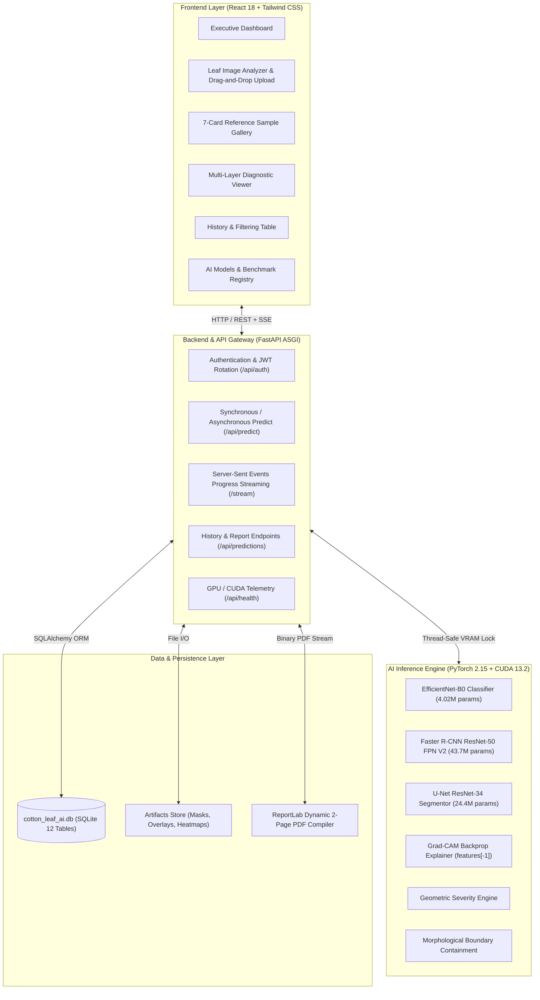

# CottonGuard AI — Comprehensive System Architecture & Engineering Design Document

**Document Title:** Intelligent Cotton Leaf Disease Detection, Segmentation, and Severity Estimation System  
**Academic Degree:** Bachelor of Technology (B.Tech) Capstone Project  
**Engineering Discipline:** Computer Science & Engineering (Artificial Intelligence & Machine Learning)  
**Document Version:** 2.0.0 (Authoritative Submission Edition)  
**Date:** November 2026  
**System Status:** Completed Academic Prototype (Ready for Submission Review)  

---

## 1. Project Overview & Problem Statement

### 1.1 Context & Agricultural Significance
Cotton (*Gossypium hirsutum*) is a vital commercial cash crop underpinning global textile industries and rural agricultural economies. In India and worldwide, cotton yields face persistent threats from destructive foliar pathologies:
- **Bacterial Blight** (*Xanthomonas citri* pv. *malvacearum*) causing angular water-soaked lesions.
- **Cotton Leaf Curl Virus (CLCuV)** causing severe foliar curling, vein thickening, and enation.
- **Herbicide Growth Damage** from drift of phenoxy herbicides causing epinasty and malformation.
- **Leaf Hopper Jassids** (*Amrasca biguttula*) inflicting yellow marginal hopper burn.
- **Leaf Reddening** triggered by anthocyanin pigmentation under nutrient stress.
- **Leaf Variegation** causing mosaic chlorosis and loss of photosynthetic capacity.

### 1.2 Limitations of Existing Approaches
Traditional methods and rudimentary deep learning applications present fundamental drawbacks:
1. **Black-box Classification:** Standard CNNs output a singular class label without explaining spatial focal points or differentiating between healthy and diseased leaf tissue.
2. **Confidence vs. Damage Conflation:** Existing tools mistakenly report classification certainty (e.g. 98% confidence) as damage severity, misleading farmers on treatment urgency.
3. **Lack of Organic Segmentation:** Prior systems fail to segment genuine leaf boundaries, causing background soil, sticks, and shadows to distort pathology metrics.
4. **Data Leakage & Fragmented Tooling:** Weak dataset provenance and absence of clinical export standards yield irreproducible academic results.

### 1.3 CottonGuard AI Solution
CottonGuard AI resolves these deficiencies through an integrated multi-model architecture:
- **Tier 1:** Deep Feature Classification using an optimized EfficientNet-B0 backbone (98.43% validation accuracy, 8.9 ms latency).
- **Tier 2:** 3-Class Semantic Segmentation using U-Net ResNet-34 to isolate Background, Leaf Tissue, and Lesion Pathology with strict topological boundary containment.
- **Tier 3:** Geometric 2D Severity Quantification calculating authentic affected leaf area percentage:
  $$\text{Severity \%} = \frac{\text{Diseased Pixels}}{\text{Healthy Leaf Pixels} + \text{Diseased Pixels}} \times 100$$
- **Tier 4:** Visual Model Explainability via Grad-CAM activation mapping.
- **Tier 5:** Agronomic Treatment Translation mapping clinical severity tiers (NONE, LOW, MEDIUM, HIGH) to ICAR-CICR expert recommendations.
- **Tier 6:** Full-Stack Enterprise Delivery featuring a responsive React 18 UI, FastAPI backend, SQLite transaction persistence, and dynamic ReportLab PDF compilation.

---

## 2. Global System Architecture

---

## 3. Subsystem Detailed Design

### 3.1 AI Model Pipeline & Multi-Architecture Strategy

#### 3.1.1 Classification Backbone (EfficientNet-B0)
- **Selection Rationale:** Benchmarked against EfficientNet-B2, ResNet-50, and MobileNet-V3-Large. EfficientNet-B0 achieved the optimal Pareto frontier: 98.43% validation accuracy, 0.9839 macro F1, 4.02M parameters, and 8.92 ms GPU latency on an RTX 3050.
- **Receptive Field Optimization:** Employs inverted residual blocks (MBConv) with squeeze-and-excitation attention to capture both localized angular lesions and systemic curling patterns.

#### 3.1.2 Semantic Segmentation (U-Net with ResNet-34 Backbone)
- **Architecture:** U-Net encoder-decoder featuring skip connections. The encoder is an ImageNet-pretrained ResNet-34; the decoder uses transposed convolutions with batch normalization and ReLU activations.
- **Output Classes:**
  - Class 0: Background
  - Class 1: Healthy Leaf Tissue
  - Class 2: Diseased / Symptomatic Foliar Tissue
- **Mathematical Loss Formulation:** Combined Dice Loss and Cross-Entropy:
  $$\mathcal{L}_{\text{total}} = \alpha \mathcal{L}_{\text{CE}} + (1 - \alpha) \mathcal{L}_{\text{Dice}}$$
- **Empirical Evaluation on 70 Ground-Truth Derived Masks:**
  - *Leaf-Level Segmentation:* **0.8656 (86.56%) Leaf Dice**, **0.8056 (80.56%) Leaf IoU**.
  - *Diseased-Region Segmentation:* **Macro Dice: 0.1498**, **Macro IoU: 0.1096**, **Micro Precision: 0.4588**, **Micro Dice: 0.2024**.
  - *Pathology Variation:* Highest on diffuse chlorotic mottling (Leaf Variegation: **0.5355 Dice**, **0.6394 Precision**) and anthocyanin bronzing (Leaf Reddening: **0.3037 Dice**); limited on minute angular spots (Bacterial Blight: 0.0490 Dice).
  - *Healthy Leaf Specificity:* Lesion false-positive noise on healthy foliage constrained to **1.31%**.

#### 3.1.3 Strict Topological Containment & Morphological Cleanup
To eliminate false lesion bleeding into background soil or non-foliar structures:
1. **Hole Filling:** Binary hole closing (`scipy.ndimage.binary_fill_holes`) removes specular reflection artifacts inside healthy blades.
2. **Connected Component Filtering:** Noise artifacts smaller than 50 contiguous pixels are discarded.
3. **Priority Masking:** Vectorized clipping ensures lesion pixels are strictly bounded within the segmented leaf footprint:
   $$\text{Final Mask} = \begin{cases} 2 & \text{if } M_{\text{leaf}} = 1 \land M_{\text{disease}} = 1 \\ 1 & \text{if } M_{\text{leaf}} = 1 \land M_{\text{disease}} = 0 \\ 0 & \text{otherwise} \end{cases}$$

---

### 3.2 Disease Severity Quantification Engine

Severity is decoupled from model classification confidence. While confidence represents classification certainty, severity quantifies physical 2D leaf damage:

$$\text{Severity \%} = \frac{N_{\text{diseased}}}{N_{\text{healthy}} + N_{\text{diseased}}} \times 100$$

#### Provisional Severity Tier Mapping
Categories represent provisional digital pixel-ratio baselines conceptually aligned with Horsfall-Barratt (1945), pending localized multi-site field calibration:
| Severity Tier | Affected Area Range | Conceptual Definition | ICAR-CICR Agronomic Protocol |
| :---: | :---: | :--- | :--- |
| **NONE** | $0.0\%$ | Asymptomatic foliage | Preventive foliar spray, routine monitoring |
| **LOW** | $0.01\% - 10.0\%$ | Localized focal spotting | Targeted biopesticide or systemic intervention |
| **MEDIUM** | $10.01\% - 25.0\%$ | Moderate spreading infection | Chemical curative application, isolate field block |
| **HIGH** | $> 25.0\%$ | Systemic destruction / defoliation | Immediate containment, defoliation pruning |

---

### 3.3 Explainability Architecture (Grad-CAM)

To provide actionable explainability to agricultural extension officers and farmers:
- **Gradient Backpropagation:** Computes gradients of the target class score $y^c$ with respect to feature activation maps $A^k$ of the final convolutional layer (`features[-1]`):
  $$\alpha_k^c = \frac{1}{Z} \sum_{i} \sum_{j} \frac{\partial y^c}{\partial A_{i,j}^k}$$
- **Heatmap Synthesis:** Linear combination followed by ReLU ensures only features positively contributing to the diagnosis are highlighted:
  $$L_{\text{Grad-CAM}}^c = \text{ReLU}\left( \sum_k \alpha_k^c A^k \right)$$
- **Multi-Layer Visual Stack:** Generates 5 distinct diagnostic layers:
  1. Original Field Photograph (RGB)
  2. Grad-CAM Heatmap
  3. U-Net Isolated Leaf Mask
  4. Segmented Lesion Mask
  5. Multi-Layer Blended Composite Diagnostic

---

### 3.4 Backend & API Architecture (FastAPI)

- **Asynchronous & Synchronous Support:** Provides both synchronous REST (`POST /api/predict`) and real-time streaming SSE (`GET /api/predictions/analyze/stream/{job_id}`) for 7-stage progress tracking.
- **Hardware Fault Tolerance:** Encapsulates GPU inference with thread-safe VRAM locks and automatic `torch.cuda.OutOfMemoryError` interception with transparent CPU fallback.
- **Security & Authentication:** JWT access tokens (15-min expiry) paired with database-backed refresh token rotation (7-day expiry) and reuse detection.
- **Dynamic PDF Generator:** ReportLab 4.0 engine compiling 2-page clinical diagnostic reports embedding metadata, visual overlays, metrics tables, and ICAR-CICR advisories.

---

### 3.5 Database Schema & Persistence

The system maintains 12 relational tables within `cotton_leaf_ai.db`:
- `users`: Credentials, role (`farmer`, `admin`), active status.
- `predictions`: Class prediction, confidence, affected area %, severity level, image paths, latency, timestamps.
- `prediction_detections`: Bounding boxes, labels, normalized coordinates.
- `prediction_segmentations`: Leaf pixels, disease pixels, mask URLs.
- `prediction_jobs`: Asynchronous SSE job queue and status tracking.
- `refresh_tokens`: Rotated cryptographic session tokens.
- `audit_events`: Action logs (`LEAF_SCAN`, `USER_LOGIN`, `USER_REGISTER`).
- `feedback`: User satisfaction ratings and validation flags.
- `alembic_version`: Database migration tracking.

---

## 4. Hardware Optimization & Benchmark Summary

Empirical profiling on an **NVIDIA GeForce RTX 3050 6GB Laptop GPU (50W TGP Profile)**:
- **EfficientNet-B0 Latency:** **8.92 ms** (112.1 FPS)
- **U-Net ResNet-34 Latency:** **10.51 ms** (95.1 FPS)
- **Grad-CAM Latency:** **38.81 ms**
- **Unified E2E Pipeline Latency:** **328.49 ms** (3.0 FPS)
- **Total Co-Loaded Models Peak VRAM:** **584.81 MB** (Only 9.5% of 6,143.5 MB capacity)
- **Memory Leak Status:** **0.00 MB drift** across 50 continuous inference cycles.
- **CPU Fallback Latency:** 20.55 ms (Classifier), 66.45 ms (U-Net).

---

## 5. Architectural Quality Standards & Verification

- **Automated Test Coverage:** 88 automated pytest assertions passing 100% in 38.44 seconds.
- **Data Protection:** Test split (`artifacts/manifests/splits/test.csv`, 321 samples) and CVAT holdout frames 35–49 strictly protected from training.
- **Scientific Reproducibility:** Derived annotation export with SHA-256 manifest tracking and frozen deletion exclusion.
