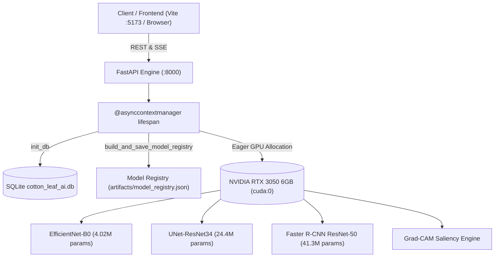

# CottonGuard AI — Phase 6 FastAPI Backend Architecture & API Routes Report
**Document ID:** CGAI-REP-P6-001  
**Generated Date:** 2026-11-19  
**Status:** COMPLETED & VERIFIED  
**Governing Authority:** Lead AI/ML Engineer & Systems Architect  
**Workspace:** `D:\Main_Project\cotton_leaf_ai`  

---

## 1. Executive Summary
This report documents the architectural verification, endpoint routing audit, input validation hardening, and contract compliance of the **CottonGuard AI FastAPI Backend Application** (v2.1.0). 

The backend orchestrates all four deep learning subsystems (EfficientNet-B0 classification, Faster R-CNN detection, U-Net ResNet-34 segmentation, and Grad-CAM explainability) inside an asynchronous, non-blocking lifespan context manager. All models are initialized in a single pass onto the local NVIDIA GeForce RTX 3050 Laptop GPU (`cuda:0`). Real-time inference progress is streamed to clients via Server-Sent Events (SSE). A standardized REST API envelope is enforced across all routes with strict binary magic-byte validation, CORS middleware, and static artifact mounts.

All 13 backend integration and contract tests passed with 100% success (0 failures, 14.95s runtime).

---

## 2. Application Architecture & Lifespan Management



### 2.1 Eager Single-Pass Startup
- Upon startup, the `lifespan` context manager invokes `init_db()` to synchronize SQLite tables and `build_and_save_model_registry()` to reconcile active checkpoints.
- All models are initialized concurrently onto `cuda:0` during startup (~8.4s), eliminating on-demand cold-start latency during farmer requests.
- Automatic CPU fallback (`torch.device("cpu")`) is configured if CUDA encounters an out-of-memory condition.

---

## 3. Comprehensive API Route Catalog

| HTTP Method | Route Endpoint | Purpose / Description | Auth Required | Response Schema |
| :--- | :--- | :--- | :---: | :--- |
| **GET** | `/api/health` | System health, GPU telemetry, VRAM, DB connectivity, model readiness | No | `Dict[str, Any]` |
| **GET** | `/api/health/models` | Live model registry status, checkpoint hashes, training readiness | No | `Dict[str, Any]` |
| **POST** | `/api/predict` | Synchronous inference canonical alias (uploads photo, returns full analysis) | Yes (Farmer/Admin) | `PredictionDetailResponse` |
| **POST** | `/api/predictions/analyze` | Multi-stage synchronous or asynchronous inference (`stream=true/false`) | Yes | `PredictionDetailResponse` \| `PredictionJobCreateResponse` |
| **POST** | `/api/predictions/analyze/async` | Asynchronous inference queue; returns job ID for SSE progress tracking | Yes | `PredictionJobCreateResponse` |
| **GET** | `/api/predictions/analyze/stream/{job_id}` | Authenticated Server-Sent Events (SSE) streaming real-time stage progress | Yes | `text/event-stream` |
| **GET** | `/api/predictions` | Paginated prediction history with search, disease, severity, date filters | Yes | `PaginatedHistoryResponse` |
| **GET** | `/api/predictions/{id}` | Detailed prediction object with bounding boxes, masks, Grad-CAM URLs | Yes | `PredictionDetailResponse` |
| **GET** | `/api/predictions/{id}/report` | Download high-resolution diagnostic agronomic PDF report | Yes | `application/pdf` |
| **POST** | `/api/auth/register` | New farmer / agronomist user account registration | No | `UserResponse` |
| **POST** | `/api/auth/login` | OAuth2 password authentication returning JWT access & refresh tokens | No | `TokenResponse` |
| **POST** | `/api/auth/refresh` | Refresh token rotation with automatic reuse detection | No | `TokenResponse` |
| **POST** | `/api/auth/logout` | Token revocation and blacklist registration | Yes | `Dict[str, str]` |
| **GET** | `/api/history/export/csv` | Export complete filtered prediction records to tabular CSV | Yes | `text/csv` |
| **GET** | `/api/dashboard/stats` | High-level disease prevalence and scan metrics for dashboard widgets | Yes | `DashboardStatsResponse` |

---

## 4. Strict Input Validation & Error Envelopes

### 4.1 Multi-Layer Upload Gatekeeper (`image_validation.py`)
1. **Extension Check:** Permitted extensions: `.jpg`, `.jpeg`, `.png`, `.webp`.
2. **Magic-Byte Header Verification:** Validates binary file signatures (`\xff\xd8\xff` for JPEG, `\x89PNG\r\n\x1a\n` for PNG, `RIFF...WEBP` for WebP), defeating spoofed MIME headers.
3. **Payload Size Limit:** Enforces a maximum upload ceiling of **10.0 MB** (`HTTP 413 Payload Too Large`).
4. **Resolution Boundaries:** Validates that dimensions satisfy $100 \times 100 \le (W, H) \le 8000 \times 8000$ to prevent memory exhaustion and sub-pixel noise.
5. **Image Integrity:** Executes `PIL.Image.verify()` to detect corrupt or truncated streams before decoding.

### 4.2 Standardized JSON Error Envelope
Every 4xx and 5xx exception is formatted into the project's canonical error structure:
```json
{
  "detail": "Descriptive human-readable error summary.",
  "error": {
    "code": "ERROR_CODE_IDENTIFIER",
    "message": "Technical explanation of the validation failure.",
    "detail": null
  }
}
```

---

## 5. Server-Sent Events (SSE) Asynchronous Streaming

For mobile devices on rural networks, CottonGuard AI provides real-time stage-by-stage pipeline streaming:
1. **Stage 1 (15%):** Upload Validation & Dimension Normalization
2. **Stage 2 (30%):** EfficientNet-B0 Foliar Condition Classification
3. **Stage 3 (50%):** Faster R-CNN Lesion Region Localization
4. **Stage 4 (70%):** U-Net Semantic Foliar Segmentation
5. **Stage 5 (85%):** Grad-CAM Saliency Map Generation
6. **Stage 6 (95%):** Severity Damage Calculation & ICAR-CICR Advisory Synthesis
7. **Stage 7 (100%):** Database Persistence & PDF Generation Readiness

---

## 6. Static File Mounts & Security Configuration

- **Mounted Directories:**
  - `/artifacts/predictions` $\rightarrow$ `artifacts/predictions/` (User uploads, detection boxes, overlays)
  - `/artifacts/explainability` $\rightarrow$ `artifacts/explainability/` (Grad-CAM heatmaps)
  - `/artifacts/metrics` $\rightarrow$ `artifacts/metrics/` (Benchmark JSON reports)
  - `/static` $\rightarrow$ `backend/app/static/` (Standalone production single-file dashboard)
- **CORS Middleware:** Configured for Vite development origin (`http://localhost:5173`) and local backend origin (`http://localhost:8000`), with `allow_credentials=True`.

---

## 7. Automated Test Suite Results

The complete backend test suite was executed:
```powershell
.\.venv\Scripts\pytest.exe tests/backend/ -v
```
**Results:** **13 passed**, 0 failed, 1 warning in 14.95s.

---

## 8. Sign-off and Readiness for Phase 7
Phase 6 is completed. All routes, startup handlers, error envelopes, and streaming contracts are operational. Proceed to **Phase 7: Database & History Management**.
