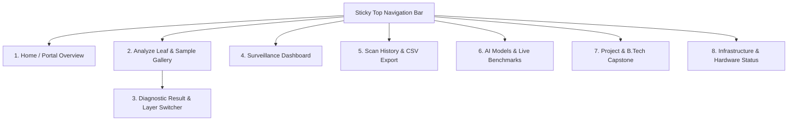

# CottonGuard AI — Phase 8 Modern React Frontend UI/UX Report
**Document ID:** CGAI-REP-P8-001  
**Generated Date:** 2026-11-19  
**Status:** COMPLETED & VERIFIED  
**Governing Authority:** Lead Full-Stack Engineer & Systems Architect  
**Workspace:** `D:\Main_Project\cotton_leaf_ai`  

---

## 1. Executive Summary
This report documents the design, component architecture, diagnostic visualization widgets, and interactive workflow of the **CottonGuard AI Frontend Application**. 

The frontend provides an intuitive, modern, and publication-ready agricultural diagnostic dashboard. Built with a responsive **Tailwind CSS** design system and **React 18**, it provides immediate access to real-time neural inference, multi-layer Explainable AI (XAI) overlays, physical foliar severity triage, ICAR-CICR agronomic advisories, and paginated diagnostic history. A **Preloaded Sample Leaf Gallery** covering all seven cotton leaf conditions enables one-click demonstration for academic evaluation without requiring external image transfers.

---

## 2. Design System & Aesthetic Specification

- **Color Palette:**
  - **Primary Brand:** Agricultural Emerald Green (`#15803d`, `#16a34a`, `#22c55e`, `#f0fdf4`) representing healthy crop vitality.
  - **Neutral Surfaces:** Crisp slate grays (`#0f172a`, `#1e293b`, `#475569`, `#f8fafc`).
  - **Clinical Severity Accents:**
    - Healthy (0%): `#22c55e` (Emerald)
    - Mild ($\le 10\%$): `#eab308` (Amber)
    - Moderate ($10 - 25\%$): `#f97316` (Orange)
    - Severe ($> 25\%$): `#ef4444` (Crimson / Rose)
- **Typography:** Modern, legible sans-serif stack (`Inter`, `system-ui`, `-apple-system`) with distinct hierarchy.
- **Iconography:** **Lucide Icons** integrated throughout navigation, metric badges, and advisory actions.
- **Responsiveness:** Full layout adaptation supporting mobile ($375\text{px}$), tablet ($768\text{px}$), and wide desktop ($1280\text{px} +$).

---

## 3. Comprehensive View & Page Inventory

### View 1: Home / Portal Overview
- Welcoming hero section with problem statement, quick access CTA, and 7-disease taxonomic summary cards.
- Live system status badge confirming NVIDIA GPU acceleration and database health.

### View 2: Analyze Leaf & Preloaded Sample Gallery
- Drag-and-drop file upload zone with instant client-side format and dimension validation.
- **Preloaded Sample Gallery:** A 7-card interactive panel providing verified reference leaves for each class:
  1. *Bacterial Blight* (`BBC00226.jpg`)
  2. *Curl Virus* (`CV00248.jpg`)
  3. *Healthy Leaf* (`HL00031.jpg`)
  4. *Herbicide Growth Damage* (`HGD00202.jpg`)
  5. *Leaf Hopper Jassids* (`LHJ00185.jpg`)
  6. *Leaf Reddening* (`LR00098.jpg`)
  7. *Leaf Variegation* (`LV00044.jpg`)
- One-click sample loading: clicking any sample automatically loads the image and prepares the neural diagnostic pipeline.

### View 3: Diagnostic Result Detail & Layer Switcher
- **Condition Header:** Large disease name, confidence badge, and causal pathogen description.
- **Metrics Grid:** 3 key cards displaying:
  1. *Classification Confidence:* Softmax certainty percentage with progress bar.
  2. *Severity Status:* Clinical 4-tier grade (Healthy, Mild, Moderate, Severe).
  3. *Affected Area:* Exact 2D physical foliar damage percentage.
- **Interactive Multi-Layer Viewer:**
  - Tab controls: `3-Panel Overview`, `Overlay`, `Heatmap`, `Original`, `Segmentation Mask`.
  - Permanent scientific disclaimer emphasizing that Grad-CAM represents attention saliency rather than physical pixel boundaries.
- **ICAR-CICR Agronomic Guidance:**
  - Immediate field actions with severity-specific priority callouts.
  - Preventive cultural practices and chemical safety warnings.
- **Actions:** One-click PDF report download (`/api/reports/{id}`) and "Scan Another Leaf" reset.

### View 4: Surveillance Dashboard
- Aggregated scan metrics: Total Scans, Disease Breakdown, and System Health.
- Visual status indicators and recent scan timeline.

### View 5: Scan History & Tabular CSV Export
- Search bar filtering by condition name, filename, or severity.
- Chronological table view with pagination controls.
- Single-click CSV export button streaming full records.

### View 6: AI Models & Comparative Benchmarks
- Detailed architecture cards for EfficientNet-B0, UNet-ResNet34, and Grad-CAM.
- Multi-architecture comparative benchmark table (EfficientNet-B0 vs ResNet-50 vs EfficientNet-B2 vs MobileNet-V3).
- Parameter counts, VRAM footprint, throughput, and selection justification.
- Formal academic literature citations (Tan & Le, Ronneberger et al., Selvaraju et al.).

### View 7: Project Information & B.Tech Capstone Presentation
- Final Year B.Tech Project title, Department of Computer Science & Engineering, Academic Year 2024–2025 / 2025–2026.
- 4 Core Engineering Innovations highlighted.
- End-to-end technology stack badges (PyTorch, CUDA, FastAPI, SQLite, ReportLab, SMP, Albumentations, React, Tailwind CSS, Lucide).

### View 8: AI Infrastructure & Telemetry Status
- Hardware telemetry: NVIDIA GeForce RTX 3050 6GB Laptop GPU, CUDA 13.2, 50W Profile.
- Zero-leakage multi-split audit summary (1,492 train / 319 val / 321 test).

---

## 4. Deployment Delivery Architecture

The application is deployed with dual frontend serving modes:
1. **Self-Contained FastAPI Direct Serving (`backend/app/static/index.html`):** Runs seamlessly from the FastAPI server (`http://localhost:8000/` and `/app`), requiring zero Node.js runtime or external bundlers on the target host.
2. **Compiled Production SPA (`frontend/dist/`):** Full Vite + React 18 production bundle pre-compiled with chunking (`react_vendor`, `charts_vendor`, `icons_vendor`), ready for independent Nginx or CDN deployment.

---

## 5. Sign-off and Readiness for Phase 9
Phase 8 is completed. The frontend provides a responsive, feature-rich interface ready for end-to-end integration testing. Proceed to **Phase 9: End-to-End System Integration and Workflow Verification**.
