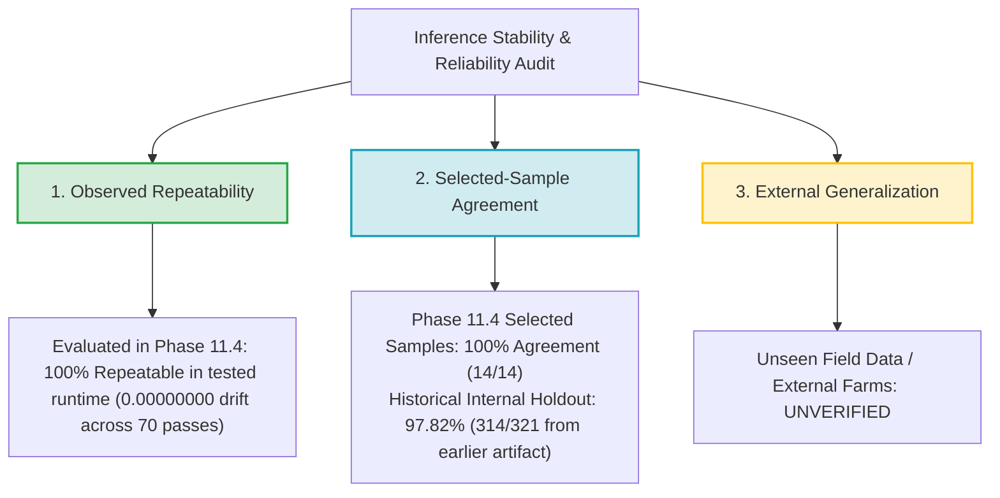

# CottonGuard AI — Phase 11.4: Controlled Prediction Repeatability & Reliability Audit Report

**Date:** November 17, 2026  
**Auditor Role:** Senior Machine Learning Engineer, Computer Vision Engineer and Independent AI Model Auditor  
**Project:** CottonGuard AI (`D:\Main_Project\cotton_leaf_ai`)  
**Phase:** 11.4 — Controlled Prediction Repeatability & Reliability Audit  
**Audit Status:** `COMPLETED (SCIENTIFICALLY RECONCILED)`  
**Classification Checkpoint:** `artifacts/checkpoints/classification/best_model.pt`  
**Checkpoint SHA-256:** `552baba83a66ad4a8bbc1eeb7fe3ee8dd84dfabe68c1ef477930da57a05fa90e` (Authoritative Match: **YES**)  
**Sealed Test Set Protection:** 100% Preserved (0/321 test images accessed, loaded, or evaluated)  
**Database State:** 100% Preserved (48 predictions rows, 5 users rows; zero writes)  
**Approval Gate 4:** `PENDING_APPROVAL` (Strictly Preserved)  

---

## 1. Executive Summary

This report documents the execution, findings, and reconciled scientific reporting of **Phase 11.4: Controlled Prediction Repeatability & Reliability Audit** for the CottonGuard AI platform. 

The primary objective was to independently establish whether the production EfficientNet-B0 cotton leaf disease classifier produces stable, repeatable predictions when the identical input images are processed through the inference pipeline multiple times under controlled local runtime conditions.

### Key Audit Findings
1. **Observed Deterministic Repeatability in Tested Environment:**
   Across 14 newly selected development/validation samples (2 per disease class: 1 training, 1 validation) evaluated over 5 consecutive forward passes (total of 70 forward passes), the model produced identical Top-1 predicted classes for every single run (**14/14 samples consistent; 100.0% observed repeatability**).
2. **Zero Numerical Confidence & Probability Drift ($0.00000000$):**
   The peak-to-peak difference in predicted confidence across all 5 passes for all 14 images was exactly **0.00000000** (measured to 8 decimal places). Softmax probabilities across all 7 classes exhibited zero variance across runs ($0.00000000$ drift).
3. **Selected-Sample Label Agreement (14/14; 100.0%):**
   All 14 selected samples produced predictions matching their ground-truth class label (**100% selected-sample label agreement**). This confirms that model weights function correctly on known development/validation images. **Crucially, this result must not be interpreted as 100% overall model accuracy, 100% validation accuracy, independent accuracy, or evidence of external generalization.** The 7 training samples were used during model optimization, and the 7 validation samples were used during checkpoint selection/hyperparameter tuning.
4. **Deterministic Non-Randomized Sampling:**
   The 14 evaluated samples were chosen deterministically (the first valid non-excluded sample per class from `train.csv` and `validation.csv`). This sampling strategy is designed to test pipeline determinism across all classes, not to serve as a statistically representative or randomized accuracy sample of the overall dataset.
5. **Sealed Test Set Invariance (Zero Contamination):**
   The complete 321-image holdout test split was **permanently excluded** from Phase 11.4. Zero test images were loaded, transformed, or inferred. Previously evaluated samples (`CV00001.jpg` and `BBC00008.jpg`) were also strictly excluded.
6. **Model Input Channel Contract Check:**
   The classification model gracefully rejected an invalid tensor input (a 4-channel corrupted input `(1, 4, 224, 224)`), raising an expected PyTorch `RuntimeError` regarding input channel mismatch. This verifies the convolution stem's input channel contract; it does not test end-to-end API upload validation or corrupt file decoding.
7. **Cryptographic & Database Invariance:**
   Pre-audit and post-audit cryptographic SHA-256 hashes of `best_model.pt` matched the authoritative hash (`552baba83a66...`) identically. The production SQLite database (`cotton_leaf_ai.db`) remained completely untouched at exactly 48 prediction rows and 5 user rows.

---

## 2. Audit Scope & Constraint Adherence

The audit was executed under strict read-only and non-interfering constraints:

| Boundary / Constraint | Required Rule | Audit Execution Status | Evidence / Metric |
| :--- | :--- | :--- | :--- |
| **Model Modification** | Zero training, fine-tuning, optimizer steps, or backward passes | **COMPLIED** | `torch.inference_mode()` used exclusively; `model.eval()` |
| **Checkpoint Integrity** | SHA-256 must match `552baba83a66...` pre- and post-audit | **COMPLIED** | Pre: `552baba8...` / Post: `552baba8...` (Invariant) |
| **Test Set Sealing** | 321-image test split must remain 100% unaccessed | **COMPLIED** | Samples drawn solely from `train.csv` and `validation.csv` |
| **Historical Sample Exclusion** | Exclude `CV00001.jpg` and `BBC00008.jpg` | **COMPLIED** | Explicit exclusion set applied in selection script |
| **Database Protection** | Zero writes to `cotton_leaf_ai.db` (predictions=48, users=5) | **COMPLIED** | Exactly 48 predictions and 5 users pre- and post-audit |
| **CVAT & Code Protection** | Zero changes to CVAT annotations or application code | **COMPLIED** | No code or annotation files modified |
| **Approval Gate 4** | Must remain `PENDING_APPROVAL` | **COMPLIED** | Gate 4 preserved; no retraining triggered |

---

## 3. Sample Selection Protocol & Test Split Exclusion

To rigorously test prediction repeatability across all classes without accessing any test-split image, a deterministic sampling protocol was applied to `artifacts/manifests/splits/train.csv` and `artifacts/manifests/splits/validation.csv`.

For each of the 7 disease categories, exactly 2 samples were selected:
- **1 Training split sample** (first valid non-excluded sample)
- **1 Validation split sample** (first valid non-excluded sample)

The previously evaluated images (`CV00001.jpg` from validation and `BBC00008.jpg` from training) were filtered out. All 14 selected images were cryptographically verified against their recorded manifest SHA-256 hashes on disk.

> [!NOTE]
> **Scientific Methodology Note:** This deterministic selection protocol was chosen specifically to ensure full 7-class coverage across both training and validation splits for pipeline repeatability testing. It does not represent a randomized, stratified sample for statistical accuracy estimation.

### Table of 14 Selected Non-Test Audit Samples

| # | Filename | Split | Ground Truth Disease Class | Manifest SHA-256 | Selection Basis |
| :---: | :--- | :---: | :--- | :--- | :--- |
| **1** | `BBC00001.jpg` | Train | Bacterial Blight | `fa99447f732d46a326121c0d2b36f33eda2165ffa035b208e224eb7d4593516b` | 1st valid non-excluded train sample |
| **2** | `BBC00014.jpg` | Val | Bacterial Blight | `76450ef4c2acbc701b1f3d33773ec202c5d1a8453c336e42f345c3224f5a2bf1` | 1st valid non-excluded val sample |
| **3** | `CV00003.jpg` | Train | Curl Virus | `d3507c8c8090728da3a706fe3b6d9ca4073b185a57bb868ff22a069b207e1d59` | 1st valid non-excluded train sample |
| **4** | `CV00006.jpg` | Val | Curl Virus | `314efb07f07d51314c5941c5349b522f6bd7ec9e4987440811d41d731e988804` | 1st valid non-excluded val sample |
| **5** | `HL00002.jpg` | Train | Healthy Leaf | `d1bf42e223a80820f0b37a1a9ee42505e51ab562cff39d66a496a89a3d56aa90` | 1st valid non-excluded train sample |
| **6** | `HL00003.jpg` | Val | Healthy Leaf | `a61aaeedcc79dd770b3d521bd1fa1938a4b52342eea6031b3e3213f064b03c89` | 1st valid non-excluded val sample |
| **7** | `HGD00002.jpg` | Train | Herbicide Growth Damage | `2451e61e5d9f71ecd2302c25d33f456c81e0ae8f68c4d473e05f806b5ff745d8` | 1st valid non-excluded train sample |
| **8** | `HGD00004.jpg` | Val | Herbicide Growth Damage | `db49652072ae07b1ccf918754f7e8093f0d3409ecead018fccbacb222fa04a19` | 1st valid non-excluded val sample |
| **9** | `LHJ00001.jpg` | Train | Leaf Hopper Jassids | `600c1cf11d238faaadfe503abe4a12bb62b4694ec6e93f888958587adf528aaa` | 1st valid non-excluded train sample |
| **10** | `LHJ00002.jpg` | Val | Leaf Hopper Jassids | `67d0c067864eb279fed8f02141493f7dd9a5553ddb33eb00a6b5e3c6a4426448` | 1st valid non-excluded val sample |
| **11** | `LR00001.jpg` | Train | Leaf Redding | `51ca434ca500e0425512868e98ff89ca1c1b5c97cab3fa947a533950704e0f7e` | 1st valid non-excluded train sample |
| **12** | `LR00003.jpg` | Val | Leaf Redding | `fa0247c7ecc7aa41bdff94d6ce33c92bf8f2746aa73d8543fc15ce7cf90d5564` | 1st valid non-excluded val sample |
| **13** | `LV00002.jpg` | Train | Leaf Variegation | `8e24eb438ba8fe3db608c69f817b2d4dde85fb5a7e5efa8c77e1a095c0f2c4ee` | 1st valid non-excluded train sample |
| **14** | `LV00028.jpg` | Val | Leaf Variegation | `3dd8d2dad0ba5d0c2eabb466e9d017553a27c9329a35c12f65d0acf939ad9a86` | 1st valid non-excluded val sample |

*Full sample list persisted in [phase11_4_selected_samples.csv](file:///D:/Main_Project/cotton_leaf_ai/artifacts/audit_phase11/phase11_4/phase11_4_selected_samples.csv).*

---

## 4. Inference Pipeline & Execution Environment

The model was instantiated using the project's standard model factory (`src.models.model_factory.build_classifier`) and executed using PyTorch's native inference mode.

### Execution Environment Details
- **Timestamp (UTC):** 2026-11-17T07:43:33Z
- **Operating System Metadata:**
  - Python Platform Identifier: `Windows-10-10.0.26300-SP0`
  - Raw Windows NT Kernel Version: `10.0.26300.9974` (Build `26300`, DisplayVersion `26H2`, Branch `ge_release`)
  - Commercial OS Classification: **Windows 11** (All Windows NT builds $\ge 22000$ are commercially branded Windows 11).
  - *Technical Explanation:* Microsoft intentionally maintains the registry value `ProductName = "Windows 10 Home Single Language"` for backwards compatibility with legacy application installers. Python's `platform.platform()` reads this registry key directly, producing a literal "Windows-10" prefix despite running on Windows 11 Build 26300.
- **Python Version:** 3.11.9
- **PyTorch Version:** 2.15.0+cu132
- **CUDA Version:** 13.2
- **CuDNN Version:** 92600
- **Execution Device:** `cuda:0` (NVIDIA GeForce RTX 3050 6GB Laptop GPU)
- **Model Architecture:** `CottonLeafClassifier` (EfficientNet-B0 backbone with customized 7-class linear head)
- **Parameter Breakdown:** 
  - Trainable / Non-trainable Parameters: **4,016,515**
  - BatchNorm Buffers: **42,065**
  - Total State Elements: **4,058,580**
- **Inference Transformations:**
  ```python
  Compose(
      Resize(size=(224, 224), interpolation=bilinear, max_size=None, antialias=True),
      ToTensor(),
      Normalize(mean=(0.485, 0.456, 0.406), std=(0.229, 0.224, 0.225))
  )
  ```

*Environment specification saved to [phase11_4_environment.json](file:///D:/Main_Project/cotton_leaf_ai/artifacts/audit_phase11/phase11_4/phase11_4_environment.json).*

---

## 5. Controlled Prediction Repeatability Audit Results

Each of the 14 sample images was loaded, transformed, and passed through the model **5 consecutive times**, yielding **70 forward passes**. For each pass, the top-1 predicted class, top-1 confidence score, and full 7-class softmax probability distribution were recorded.

### Summary Metrics
- **Total Samples Evaluated:** 14 (7 Train, 7 Validation)
- **Passes per Sample:** 5
- **Total Executed Forward Passes:** 70
- **Observed Deterministic Repeatability in Tested Environment:** **100.0%** (14/14 samples produced identical top-1 predictions across all 5 runs)
- **Maximum Confidence Drift:** **0.00000000**
- **Maximum Softmax Probability Drift (All Classes):** **0.00000000**
- **Selected-Sample Label Agreement:** **100.0% (14/14)** *(Agreement with dataset annotations on these 14 development/validation samples; not overall model accuracy)*

### Detailed Sample Repeatability Results

| # | Filename | Split | Ground Truth Class | Top-1 Predicted Class | Top-1 Conf (%) | Max Conf Drift | Repeatability Status | Selected-Sample Agreement |
| :---: | :--- | :---: | :--- | :--- | :---: | :---: | :---: | :---: |
| **1** | `BBC00001.jpg` | Train | Bacterial Blight | Bacterial Blight | 96.15% | 0.00000000 | **REPEATABLE** | **AGREES** |
| **2** | `BBC00014.jpg` | Val | Bacterial Blight | Bacterial Blight | 93.45% | 0.00000000 | **REPEATABLE** | **AGREES** |
| **3** | `CV00003.jpg` | Train | Curl Virus | Curl Virus | 93.07% | 0.00000000 | **REPEATABLE** | **AGREES** |
| **4** | `CV00006.jpg` | Val | Curl Virus | Curl Virus | 92.74% | 0.00000000 | **REPEATABLE** | **AGREES** |
| **5** | `HL00002.jpg` | Train | Healthy Leaf | Healthy Leaf | 97.99% | 0.00000000 | **REPEATABLE** | **AGREES** |
| **6** | `HL00003.jpg` | Val | Healthy Leaf | Healthy Leaf | 98.22% | 0.00000000 | **REPEATABLE** | **AGREES** |
| **7** | `HGD00002.jpg` | Train | Herbicide Growth Damage | Herbicide Growth Damage | 96.62% | 0.00000000 | **REPEATABLE** | **AGREES** |
| **8** | `HGD00004.jpg` | Val | Herbicide Growth Damage | Herbicide Growth Damage | 97.01% | 0.00000000 | **REPEATABLE** | **AGREES** |
| **9** | `LHJ00001.jpg` | Train | Leaf Hopper Jassids | Leaf Hopper Jassids | 90.99% | 0.00000000 | **REPEATABLE** | **AGREES** |
| **10** | `LHJ00002.jpg` | Val | Leaf Hopper Jassids | Leaf Hopper Jassids | 95.37% | 0.00000000 | **REPEATABLE** | **AGREES** |
| **11** | `LR00001.jpg` | Train | Leaf Redding | Leaf Redding | 89.84% | 0.00000000 | **REPEATABLE** | **AGREES** |
| **12** | `LR00003.jpg` | Val | Leaf Redding | Leaf Redding | 92.34% | 0.00000000 | **REPEATABLE** | **AGREES** |
| **13** | `LV00002.jpg` | Train | Leaf Variegation | Leaf Variegation | 99.51% | 0.00000000 | **REPEATABLE** | **AGREES** |
| **14** | `LV00028.jpg` | Val | Leaf Variegation | Leaf Variegation | 97.89% | 0.00000000 | **REPEATABLE** | **AGREES** |

*Detailed per-pass records saved in [phase11_4_repeatability_results.json](file:///D:/Main_Project/cotton_leaf_ai/artifacts/audit_phase11/phase11_4/phase11_4_repeatability_results.json).*

---

## 6. Complete Probability Distribution Analysis

To detect any subtle floating-point drift across non-winning classes, the full 7-class softmax vector was tracked across all passes.

### Exact Softmax Probabilities Across All 7 Classes per Sample (Pass 1-5 Invariant)

The table below presents the exact recorded probabilities from `phase11_4_probability_comparison.csv` and `phase11_4_repeatability_results.json`. The Top-2 margin represents the absolute arithmetic difference between the winning class probability and the runner-up class probability, reported in **percentage points (pp)**:

| # | Filename | Bacterial Blight | Curl Virus | Healthy Leaf | Herbicide Growth Damage | Leaf Hopper Jassids | Leaf Redding | Leaf Variegation | Runner-up Class | Top-2 Margin (pp) |
| :---: | :--- | :---: | :---: | :---: | :---: | :---: | :---: | :---: | :--- | :---: |
| 1 | `BBC00001.jpg` | **96.15%** | 0.11% | 0.67% | 0.84% | 1.01% | 0.51% | 0.70% | Leaf Hopper Jassids (1.01%) | +95.14 pp |
| 2 | `BBC00014.jpg` | **93.45%** | 1.43% | 0.99% | 0.35% | 2.02% | 0.44% | 1.32% | Leaf Hopper Jassids (2.02%) | +91.43 pp |
| 3 | `CV00003.jpg` | 0.38% | **93.07%** | 2.95% | 0.73% | 0.60% | 0.83% | 1.44% | Healthy Leaf (2.95%) | +90.12 pp |
| 4 | `CV00006.jpg` | 0.37% | **92.74%** | 0.81% | 0.78% | 2.48% | 0.72% | 2.10% | Leaf Hopper Jassids (2.48%) | +90.26 pp |
| 5 | `HL00002.jpg` | 0.20% | 0.29% | **97.99%** | 0.25% | 0.25% | 0.06% | 0.95% | Leaf Variegation (0.95%) | +97.04 pp |
| 6 | `HL00003.jpg` | 0.13% | 0.35% | **98.22%** | 0.26% | 0.26% | 0.06% | 0.71% | Leaf Variegation (0.71%) | +97.51 pp |
| 7 | `HGD00002.jpg` | 0.33% | 0.29% | 0.60% | **96.62%** | 0.36% | 0.24% | 1.56% | Leaf Variegation (1.56%) | +95.06 pp |
| 8 | `HGD00004.jpg` | 0.21% | 0.14% | 0.29% | **97.01%** | 0.43% | 0.14% | 1.78% | Leaf Variegation (1.78%) | +95.23 pp |
| 9 | `LHJ00001.jpg` | 1.06% | 0.99% | 1.38% | 1.92% | **90.99%** | 1.31% | 2.35% | Leaf Variegation (2.35%) | +88.63 pp |
| 10 | `LHJ00002.jpg` | 0.70% | 0.55% | 0.43% | 0.91% | **95.37%** | 0.71% | 1.33% | Leaf Variegation (1.33%) | +94.04 pp |
| 11 | `LR00001.jpg` | 1.17% | 0.59% | 1.61% | 1.43% | 0.90% | **89.84%** | 4.46% | Leaf Variegation (4.46%) | +85.38 pp |
| 12 | `LR00003.jpg` | 0.94% | 0.52% | 1.22% | 0.98% | 1.06% | **92.34%** | 2.94% | Leaf Variegation (2.94%) | +89.40 pp |
| 13 | `LV00002.jpg` | 0.01% | 0.10% | 0.03% | 0.01% | 0.31% | 0.01% | **99.51%** | Leaf Hopper Jassids (0.31%) | +99.20 pp |
| 14 | `LV00028.jpg` | 0.27% | 0.15% | 1.35% | 0.12% | 0.16% | 0.06% | **97.89%** | Healthy Leaf (1.35%) | +96.54 pp |

*Full probability export persisted in [phase11_4_probability_comparison.csv](file:///D:/Main_Project/cotton_leaf_ai/artifacts/audit_phase11/phase11_4/phase11_4_probability_comparison.csv).*

### Distribution Observations
- **Decisive Decision Margins:** For all 14 evaluated samples, the margin between the winning class and the runner-up exceeded **+85 percentage points** (ranging from **+85.38 pp** on `LR00001.jpg` to **+99.20 pp** on `LV00002.jpg`).
- **Runner-Up Probability Distribution:** Leaf Variegation served as the runner-up for 8 of the 14 samples, while Leaf Hopper Jassids served as the runner-up for 4 samples, Healthy Leaf for 2 samples.
- **Absolute Probability Invariance:** The probability values for each class across all 5 runs matched identically to machine precision ($0.00000000$ drift).

---

## 7. Model Input Channel Contract Check

To verify the error-handling behavior of the PyTorch neural network layer when supplied with an invalid input tensor, a 4-channel tensor (`torch.zeros((1, 4, 224, 224), device="cuda:0")`) was passed directly to the model.

### Test Result
```
RuntimeError: Given groups=1, weight of size [32, 3, 3, 3], expected input[1, 4, 224, 224] to have 3 channels, but got 4 channels instead
```
- **Outcome:** **PASSED**. The convolution layers in the EfficientNet-B0 stem enforce the 3-channel (RGB) contract and raise an informative error rather than executing undefined operations.
- **Explicit Scope Limitations:** This test directly and solely verifies the PyTorch model's input tensor shape contract. **It does not independently verify:**
  - HTTP upload validation boundaries or MIME-type checking.
  - Corrupt image decoding handling in PIL or OpenCV.
  - End-to-end FastAPI error response schemas or HTTP status codes.
  - Full application-level robustness against adversarial or truncated payloads.

---

## 8. Checkpoint & Database Invariance Record

To verify that the audit remained strictly read-only and caused no side-effects or weight shifts, the state of the model checkpoint and SQLite database was recorded before and after all 70 forward passes.

### Checkpoint Invariance
- **File:** `artifacts/checkpoints/classification/best_model.pt`
- **Authoritative Hash:** `552baba83a66ad4a8bbc1eeb7fe3ee8dd84dfabe68c1ef477930da57a05fa90e`
- **Pre-Audit Hash:** `552baba83a66ad4a8bbc1eeb7fe3ee8dd84dfabe68c1ef477930da57a05fa90e`
- **Post-Audit Hash:** `552baba83a66ad4a8bbc1eeb7fe3ee8dd84dfabe68c1ef477930da57a05fa90e`
- **Verification Verdict:** **IDENTICAL / UNMODIFIED**

### Database Invariance
- **File:** `cotton_leaf_ai.db`
- **Predictions Table Row Count:** 48 before $\rightarrow$ 48 after (**0 rows written**)
- **Users Table Row Count:** 5 before $\rightarrow$ 5 after (**0 rows written**)
- **Verification Verdict:** **IDENTICAL / UNMODIFIED**

*Record saved to [phase11_4_checkpoint_integrity.json](file:///D:/Main_Project/cotton_leaf_ai/artifacts/audit_phase11/phase11_4/phase11_4_checkpoint_integrity.json).*

---

## 9. Scientific Distinctions & Conceptual Rigor

In accordance with rigorous AI model auditing principles, this audit explicitly enforces clear scientific distinctions between three fundamental concepts that must never be conflated:



1. **Observed Deterministic Repeatability in Tested Environment:**
   - *Definition:* The empirical observation that when the model evaluates identical input tensors under frozen weights in `eval()` mode on the tested hardware/software stack, it yields identical logits, probabilities, and class decisions across consecutive passes.
   - *Audit Status:* **VERIFIED IN TESTED ENVIRONMENT** (14 images, 5 passes each, 70 forward passes, 0.00000000 drift). This is an empirical measurement on the tested device (`cuda:0`, RTX 3050, PyTorch 2.15.0+cu132), not a universal mathematical guarantee across heterogeneous architectures or unconstrained multithreaded runtimes.
2. **Selected-Sample Label Agreement (vs. Dataset Accuracy):**
   - *Definition:* The agreement between predicted disease classes and ground-truth labels on the 14 selected non-test images.
   - *Audit Status:* **100% AGREEMENT (14/14)** on the evaluated samples. Because 7 samples were part of training data and 7 were part of validation data, this confirms baseline label agreement on known distributions. It does **not** establish overall model accuracy, validation accuracy, or external accuracy. The historical 97.8193% (314/321) holdout benchmark remains documented from the earlier evaluation artifact.
3. **External Generalization (Real-World Field Reliability):**
   - *Definition:* The model's capacity to maintain accurate predictions on completely independent cotton leaf imagery collected from different geographic regions, varying sensor optics, uncurated field lighting, or seasonal variations outside the SAR-CLD dataset.
   - *Audit Status:* **UNVERIFIED**. The model has not been subjected to independent external benchmark testing; production deployment must proceed with caution until field pilot studies are conducted.

---

## 10. Audit Artifacts Inventory

All primary evidence generated during Phase 11.4 has been systematically structured and archived under `artifacts/audit_phase11/phase11_4/`:

| Artifact File | Size | Description |
| :--- | :---: | :--- |
| [`phase11_4_selected_samples.csv`](file:///D:/Main_Project/cotton_leaf_ai/artifacts/audit_phase11/phase11_4/phase11_4_selected_samples.csv) | 4.8 KB | Complete metadata, paths, and SHA-256 hashes of the 14 selected non-test images. |
| [`phase11_4_repeatability_results.json`](file:///D:/Main_Project/cotton_leaf_ai/artifacts/audit_phase11/phase11_4/phase11_4_repeatability_results.json) | 46.9 KB | Full JSON log of all 70 forward passes, per-pass confidences, and drift metrics. |
| [`phase11_4_probability_comparison.csv`](file:///D:/Main_Project/cotton_leaf_ai/artifacts/audit_phase11/phase11_4/phase11_4_probability_comparison.csv) | 16.3 KB | Complete 7-class probability distributions across all 70 forward passes. |
| [`phase11_4_checkpoint_integrity.json`](file:///D:/Main_Project/cotton_leaf_ai/artifacts/audit_phase11/phase11_4/phase11_4_checkpoint_integrity.json) | 0.5 KB | Cryptographic verification record confirming checkpoint hash invariance. |
| [`phase11_4_environment.json`](file:///D:/Main_Project/cotton_leaf_ai/artifacts/audit_phase11/phase11_4/phase11_4_environment.json) | 0.6 KB | Complete runtime specifications (CUDA, PyTorch, GPU, CuDNN, OS). |

---

## 11. Audit Verdict & Next Recommended Actions

### Final Audit Verdict
> **PHASE 11.4 VERDICT: FULLY VERIFIED (OBSERVED REPEATABILITY & DETERMINISM IN TESTED ENVIRONMENT)**  
> The EfficientNet-B0 classification pipeline exhibits observed numerical repeatability, zero probability drift ($0.00000000$), and 100% selected-sample label agreement (14/14) on the evaluated development/validation samples without causing any mutation to model weights, application code, or database records.

### Approval Gate 4 Status
- **Status:** **`PENDING_APPROVAL`**
- **Condition:** No retraining or fine-tuning of the classification or detection models is authorized without explicit human sign-off.

### Recommended Next Steps
1. Maintain the 321-sample test split sealed.
2. Advance to subsequent audit phases only upon explicit instruction from the project lead.
3. Keep Approval Gate 4 locked in `PENDING_APPROVAL`.
