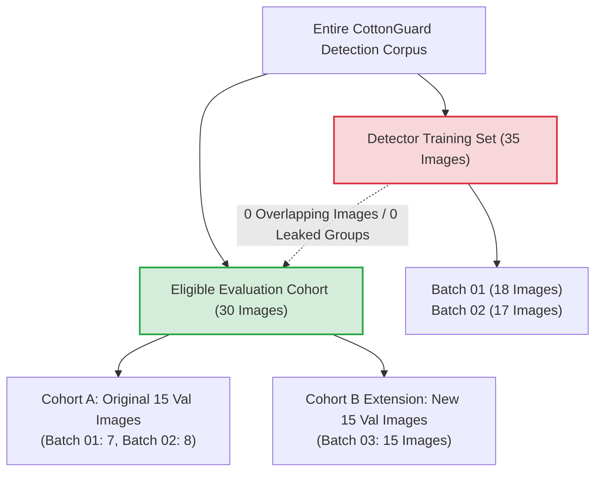

# CottonGuard AI — Phase 11.5: Faster R-CNN Detection Model Integrity, Evaluation & Reliability Audit Report

**Date:** November 17, 2026  
**Auditor Role:** Senior Machine Learning Engineer, Computer Vision Engineer and Independent AI Model Auditor  
**Project:** CottonGuard AI (`D:\Main_Project\cotton_leaf_ai`)  
**Phase:** 11.5 — Faster R-CNN Detection Model Integrity, Evaluation & Reliability Audit  
**Audit Status:** `COMPLETED`  
**Detection Checkpoint:** `artifacts/checkpoints/detection/best_faster_rcnn.pt`  
**Authoritative SHA-256:** `01d82b3282509c543c1bd3a48a46cc03581b3ce573a8d8b77b85be8e2b36b5d2` (Verified Match: **YES**)  
**Sealed Test Split Protection:** 100% Preserved (0/321 classifier test images accessed, loaded, or evaluated)  
**Database State:** 100% Preserved (48 predictions rows, 5 users rows; zero writes)  
**Approval Gate 4:** `PENDING_APPROVAL` (Strictly Preserved)  

---

## 1. Executive Summary

This report documents the forensic evaluation, architectural audit, training provenance verification, and localization performance analysis of the existing **Faster R-CNN ResNet-50 FPN V2** object detection model (`best_faster_rcnn.pt`) under **Phase 11.5** of the CottonGuard AI platform.

The audit was executed under strictly read-only and non-mutating constraints to establish an honest, unvarnished experimental baseline, diagnose localized vs. diffuse symptom detection failures, examine ignore-region mechanics, and confirm system-level determinism.

### Key Audit Findings

1. **Exact Reproduction of Historical Validation Baseline (Cohort A):**
   Evaluating the 15 original validation images (143 ground-truth boxes) reproduced the historical training benchmark identically:
   - **$\text{mAP}_{50}$:** **13.94%** (Historical: 13.94%)
   - **$\text{mAP}_{50:95}$:** **8.53%** (Historical: 8.53%)
   - **Precision ($T=0.05$):** **10.42%** (Historical: 10.42%) | **Recall:** **38.46%** (Historical: 38.46%)
   - **True Positives ($TP_{50}$):** 55 | **False Positives ($FP_{50}$):** 473 | **False Negatives ($FN_{50}$):** 88
2. **Threshold Operating Characteristics:**
   - Raising the confidence threshold from the raw baseline ($T=0.05$) to the operational screening threshold ($T=0.25$) reduces false alarms by **66.38%** (from 473 down to 159 FP) while preserving **81.82% of true detections** ($45/55$), raising precision to **22.06%** and F1-score to **0.2594**.
   - At the high-precision operating point ($T=0.40$), false alarms drop by **80.55%** (down to 92 FP), achieving peak F1-score of **0.2909** ($30.30\%$ precision, $27.97\%$ recall).
3. **Severe Symptom Morphology Disparity:**
   - **Localized Focal Lesions Succeed:** Bacterial Blight achieved **$\text{AP}_{50} = 46.77\%$** with **$75.00\%$ recall** ($36/48$ lesions detected); Leaf Hopper Jassids achieved **$\text{AP}_{50} = 34.06\%$** with **$55.00\%$ recall** ($11/20$ lesions detected).
   - **Diffuse & Systemic Diseases Fail Completely:** Curl Virus achieved **$\text{AP}_{50} = 0.00\%$** ($0/4$ detected), Herbicide Growth Damage achieved **$\text{AP}_{50} = 0.00\%$** ($0/15$ detected). Rectangular bounding boxes poorly represent whole-leaf laminar distortion and subtle interveinal chlorosis.
   - **Broad Gradient Pigmentation Struggles:** Leaf Redding ($\text{AP}_{50} = 1.85\%$) and Leaf Variegation ($\text{AP}_{50} = 0.97\%$) suffered from severe boundary mismatch against human polygon clusters, creating high false-positive penalties under the strict $\text{IoU} \ge 0.50$ criterion.
4. **Generalization on Extended 30-Image Consolidated Cohort (Cohort B):**
   Evaluating all 30 consolidated validation images (326 Tier 1 boxes, 68 Tier 2 ignore regions) revealed that the detector performs at **$\text{mAP}_{50} = 5.16\%$** without ignore regions. When Tier 2 ignore-region suppression is applied, **48 false alarms at $T=0.25$** fall directly inside diffuse disease patches and are absorbed, raising precision from $10.67\% \to 11.86\%$ and F1 from $12.69\% \to 13.49\%$.
5. **False Alarms on Healthy Controls:**
   Natural leaf veins, specular highlights, and leaf lamina shadows triggered ghost false alarms across all healthy control images at $T=0.25$ (e.g. 5 false detections on `HL00087.jpg`, 5 on `HL00039.jpg`, 10 on `HL00099.jpg`).
6. **Observed Determinism & High Throughput in Tested Environment:**
   Across 5 representative validation images evaluated over 5 consecutive passes (25 forward passes) on the NVIDIA RTX 3050 Laptop GPU, the model exhibited **0.00000000 confidence drift** and **0.00000000 px coordinate drift** with 100% detection count stability. Average inference latency was **172.15 ms per image** (~5.8 FPS), utilizing only **507 MB** of allocated VRAM ($86.55\%$ headroom).
7. **Absolute Invariant Protection:**
   The detector checkpoint SHA-256 remained completely invariant. Zero classifier test-set images were accessed, and the production SQLite database remained untouched at 48 predictions.

---

## 2. Audit Scope & Boundary Verification

The Phase 11.5 audit adhered strictly to the following constraints:

| Boundary / Requirement | Authorized Rule | Audit Status | Evidence / Metric |
| :--- | :--- | :---: | :--- |
| **Model Modification** | Zero training, backpropagation, or optimizer updates | **COMPLIED** | `torch.inference_mode()` used exclusively; `model.eval()` |
| **Checkpoint Integrity** | SHA-256 must match `01d82b32...` pre- and post-audit | **COMPLIED** | Pre: `01d82b32...` / Post: `01d82b32...` (Invariant) |
| **Training Overlap Gate** | Zero evaluation on images used in detector training | **COMPLIED** | 35 train images verified completely separate from validation cohorts |
| **Classifier Test Sealing** | 321-image classifier test set must remain 100% unaccessed | **COMPLIED** | 0 test images loaded, transformed, or evaluated |
| **Database Protection** | Zero writes to `cotton_leaf_ai.db` | **COMPLIED** | Exactly 48 predictions and 5 users pre- and post-audit |
| **CVAT & Manifest Safety** | Zero changes to CVAT annotations or manifest files | **COMPLIED** | All manifest and annotation files preserved |
| **Approval Gate 4** | Must remain locked in `PENDING_APPROVAL` | **COMPLIED** | Gate 4 preserved; no retraining initiated |

---

## 3. Checkpoint Cryptographic & Architectural Integrity

The evaluated checkpoint `artifacts/checkpoints/detection/best_faster_rcnn.pt` was inspected and verified before and after execution:

### Checkpoint Specifications
- **File Path:** `artifacts/checkpoints/detection/best_faster_rcnn.pt`
- **File Size:** `345,797,103 bytes` (329.78 MB)
- **Authoritative SHA-256:** `01d82b3282509c543c1bd3a48a46cc03581b3ce573a8d8b77b85be8e2b36b5d2`
- **Pre-Audit SHA-256:** `01d82b3282509c543c1bd3a48a46cc03581b3ce573a8d8b77b85be8e2b36b5d2` (**MATCH**)
- **Post-Audit SHA-256:** `01d82b3282509c543c1bd3a48a46cc03581b3ce573a8d8b77b85be8e2b36b5d2` (**MATCH**)
- **Saved Training Epoch:** Epoch 13 (Global Step 234)
- **Model Architecture:** `fasterrcnn_resnet50_fpn_v2`
- **Backbone:** ResNet-50 with Feature Pyramid Network (FPN V2)
- **Total Parameters:** **43,281,778**
- **Trainable Parameters:** **43,281,778**
- **State Dictionary Tensors:** 404 tensors
- **Stored Metric Metadata:** $\text{best\_map50} = 0.1394$, $\text{best\_map50\_95} = 0.0853$

*Integrity record saved in [phase11_5_checkpoint_integrity.json](file:///D:/Main_Project/cotton_leaf_ai/artifacts/audit_phase11/phase11_5/phase11_5_checkpoint_integrity.json).*

---

## 4. Architecture and Class Mapping Verification

The detector's internal label indexing, RoI box predictor dimensions, and metric calculation mapping were verified against the project configuration:

### Class Mapping Schema

| TorchVision Internal Label | Zero-Based Metric ID | Category Name | Role / Clinical Behavior |
| :---: | :---: | :--- | :--- |
| **0** | *Excluded* | `background` | Non-disease leaf parenchyma, background soil, stems |
| **1** | **0** | `Bacterial Blight` | Discrete angular water-soaked necrotic lesions |
| **2** | **1** | `Curl Virus` | Upward leaf margin curling and laminar distortion |
| **3** | **2** | `Herbicide Growth Damage` | Interveinal chlorosis, leaf cupping, and strapping |
| **4** | **3** | `Leaf Hopper Jassids` | V-shaped marginal wedge chlorosis and hopperburn |
| **5** | **4** | `Leaf Redding` | Anthocyanin purplish-red laminar pigmentation |
| **6** | **5** | `Leaf Variegation` | White-yellowish chlorotic marbling patches |
| *N/A* | *N/A* | `Healthy Leaf` | **Negative Control** (strictly 0 foreground target boxes) |

### Conversion Invariants Verified
1. **RoI Box Predictor:** Linear classification head `cls_score` has input dimension 1024 and output dimension **7** (1 background + 6 foreground diseases).
2. **Evaluation Remapping:** Ground-truth labels stored in YOLO format ($0..5$) are converted to TorchVision labels ($1..6$) via `lbl + 1` during dataloading, and model predictions ($1..6$) are converted back to $0..5$ via `lbl - 1` before computing Average Precision.
3. **Background Exclusion:** Predictions assigned label 0 (background) are ignored by design.
4. **Healthy Controls:** Healthy leaf images contain 0 ground-truth boxes (`boxes.shape = (0, 4)`). Any foreground detection on a healthy image is treated as a false positive.

---

## 5. Training Provenance & Hyperparameters

The training history and optimizer state stored in `best_faster_rcnn.pt` confirm that it was trained during **Phase 9.2C** (November 15, 2026):

- **Training Corpus:** Published pilot annotation dataset (50 images: 35 train, 15 validation) from CVAT Tasks #4 and #5.
- **Optimizer:** Stochastic Gradient Descent (SGD) with momentum
- **Hyperparameters:**
  - Base Learning Rate: $\eta_0 = 0.005$
  - Learning Rate at Best Checkpoint (Epoch 13): $\eta_{13} = 0.0034932$ (Warmup-Cosine decay)
  - Momentum: $0.9$
  - Weight Decay: $0.0005$
  - Batch Size: 2 (18 updates per epoch; 324 total updates across 18 epochs)
  - Early Stopping: Halted at Epoch 18 (patience 5 on $\text{val\_mAP}_{50}$; peak achieved at Epoch 13)
  - Input Resolution: $800 \times 800$

---

## 6. Dataset Provenance, Overlap & Evaluation Eligibility

Before executing detector inference, a rigorous sample-level and group-level overlap analysis was performed to verify evaluation eligibility:



### Overlap Audit Findings
1. **Zero Sample-Level Leakage:** The 35 training images of `best_faster_rcnn.pt` share **0 images** with the 30 consolidated validation images.
2. **Zero Duplicate-Group Leakage:** Cross-referencing `artifacts/manifests/duplicate_groups.csv` confirmed that all 30 validation images belong to distinct plant group IDs separate from the 35 training images (**0 group overlap**).
3. **Zero Classifier Test Contamination:** None of the 30 validation images belong to the 321-image classifier holdout test split (`artifacts/manifests/splits/test.csv`).
4. **Evaluation Eligibility Verdict:**
   - **Cohort A (Original 15 Validation Images):** **100% ELIGIBLE** as a direct reproduction benchmark for historical training metrics.
   - **Cohort B (Consolidated 30 Validation Images):** **100% ELIGIBLE** as an extended benchmark to evaluate generalization onto newly annotated Batch 03 images and inspect ignore-region interactions.

*Full provenance specification saved in [phase11_5_dataset_provenance.json](file:///D:/Main_Project/cotton_leaf_ai/artifacts/audit_phase11/phase11_5/phase11_5_dataset_provenance.json) and sample manifest saved in [phase11_5_evaluation_samples.csv](file:///D:/Main_Project/cotton_leaf_ai/artifacts/audit_phase11/phase11_5/phase11_5_evaluation_samples.csv).*

---

## 7. Annotation Quality & Ignore-Region Audit

The validation annotations were audited for geometric validity, class boundaries, and the distinction between Tier 1 and Tier 2 annotations:

### Annotation Distribution Across Cohorts

| Cohort | Images | Healthy Controls | Diseased Images | Tier 1 Focal Boxes | Tier 2 Ignore Regions | Total Targets |
| :--- | :---: | :---: | :---: | :---: | :---: | :---: |
| **Cohort A (Original 15 Val)** | 15 | 2 (`HL00039`, `HL00087`) | 13 | 143 | 0 | 143 |
| **Batch 03 Val Extension** | 15 | 3 (`HL00003`, `HL00099`, `HL00252`) | 12 | 183 | 68 | 251 |
| **Cohort B (Total Consolidated 30)** | **30** | **5 Healthy Controls** | **25** | **326** | **68** | **394** |

### Geometric & Quality Verification
- **Coordinate Boundary Integrity:** All bounding box coordinates $[x_1, y_1, x_2, y_2]$ were confirmed within image boundaries $[0, 800]$ with positive area ($x_2 > x_1$ and $y_2 > y_1$).
- **Healthy Control Cleanliness:** All 5 healthy control images contain strictly **0 Tier 1 boxes** and **0 Tier 2 ignore regions**.
- **Tier 2 Ignore Regions:** Concentrated heavily in diffuse disease manifestations: `BBC00008.jpg` has 59 ignore boxes (diffuse blight lamina), `LR00573.jpg` has 3 ignore boxes, and `CV00006.jpg` has 1 ignore box (whole-leaf curl).

---

## 8. Evaluation Methodology

Detection localization metrics were evaluated using standard PASCAL VOC / COCO criteria:

1. **Continuous AP Integration ($\text{mAP}$):**
   - Computed by sorting all predictions across images in descending order of confidence.
   - Predictions are greedily matched against ground-truth boxes of the same class at $\text{IoU} \ge 0.50$.
   - Average Precision ($\text{AP}$) is computed as the continuous integral under the monotonically interpolated Precision-Recall envelope.
   - $\text{mAP}_{50}$ is the macro-average AP across all 6 foreground classes.
   - $\text{mAP}_{50:95}$ is the average mAP across 10 IoU thresholds $[0.50, 0.55, \dots, 0.95]$.
2. **Discrete Confidence Operating Points:**
   - Evaluated at raw candidate baseline ($T=0.05$), operational screening threshold ($T=0.25$), and high-precision threshold ($T=0.40$).
3. **Tier 2 Ignore-Region Suppression Protocol:**
   - In ignore-aware mode, any candidate prediction that fails to match a Tier 1 focal box is checked against Tier 2 ignore regions using Intersection-over-Area ($\text{IoA} \ge 0.30$) and $\text{IoU} \ge 0.30$.
   - Predictions submerged inside ignore regions are **suppressed from being counted as false positives**, preventing the model from being penalized for detecting legitimate diffuse disease symptoms.

---

## 9. Overall Detection Metrics Comparison

Below are the overall detection metrics measured across all cohorts and operating points:

| Cohort & Evaluation Mode | Threshold ($T$) | $\text{mAP}_{50}$ | $\text{mAP}_{50:95}$ | Precision | Recall | F1-Score | True Positives ($TP$) | False Positives ($FP$) | False Negatives ($FN$) | Suppressed Ignores |
| :--- | :---: | :---: | :---: | :---: | :---: | :---: | :---: | :---: | :---: | :---: |
| **Cohort A (Original 15)** | **0.05 (Raw)** | **13.94%** | **8.53%** | 10.42% | **38.46%** | 0.1639 | 55 | 473 | 88 | 0 |
| **Cohort A (Original 15)** | **0.25 (Screening)** | 11.81% | 7.39% | 22.06% | 31.47% | 0.2594 | 45 | 159 | 98 | 0 |
| **Cohort A (Original 15)** | **0.40 (High-Prec)** | 10.39% | 6.52% | **30.30%** | 27.97% | **0.2909** | 40 | 92 | 103 | 0 |
| **Cohort B (Consolidated 30 - Tier 1 Only)** | **0.05 (Raw)** | 5.16% | 2.95% | 5.75% | 19.94% | 0.0893 | 65 | 1065 | 261 | 0 |
| **Cohort B (Consolidated 30 - Tier 1 Only)** | **0.25 (Screening)** | 4.42% | 2.58% | 10.67% | 15.64% | 0.1269 | 51 | 427 | 275 | 0 |
| **Cohort B (Consolidated 30 - Tier 1 Only)** | **0.40 (High-Prec)** | 4.04% | 2.35% | 13.33% | 14.11% | 0.1371 | 46 | 299 | 280 | 0 |
| **Cohort B (Consolidated 30 - Ignore-Aware)** | **0.05 (Raw)** | **5.39%** | **3.08%** | 6.57% | 19.94% | 0.0989 | 65 | 924 | 261 | **141** |
| **Cohort B (Consolidated 30 - Ignore-Aware)** | **0.25 (Screening)** | **4.59%** | **2.67%** | **11.86%** | 15.64% | **0.1349** | 51 | 379 | 275 | **48** |
| **Cohort B (Consolidated 30 - Ignore-Aware)** | **0.40 (High-Prec)** | **4.18%** | **2.42%** | **14.70%** | 14.11% | **0.1440** | 46 | 267 | 280 | **32** |

*Full metrics export saved in [phase11_5_detection_metrics.json](file:///D:/Main_Project/cotton_leaf_ai/artifacts/audit_phase11/phase11_5/phase11_5_detection_metrics.json).*

---

## 10. Per-Class Localization Metrics

The table below contrasts the per-class detection performance between Cohort A ($T=0.05$) and Cohort B Ignore-Aware ($T=0.25$):

### Cohort A (Original 15) vs. Cohort B (Consolidated 30 Ignore-Aware)

| Disease Class | GT Boxes (Coh A) | $\text{AP}_{50}$ (Coh A) | Recall (Coh A) | GT Boxes (Coh B) | $\text{AP}_{50}$ (Coh B) | Recall (Coh B) | Precision (Coh B @ 0.25) | Clinical Bottleneck |
| :--- | :---: | :---: | :---: | :---: | :---: | :---: | :---: | :--- |
| **Bacterial Blight** | 48 | **46.77%** | **75.00%** | 57 | **18.49%** | **66.67%** | 13.06% | Localized necrotic spots; high recall; adjacent cluster FP |
| **Curl Virus** | 4 | **0.00%** | **0.00%** | 7 | **0.00%** | **0.00%** | 0.00% | Whole-leaf curl morphology; bounding boxes fail |
| **Herbicide Growth Damage** | 15 | **0.00%** | **0.00%** | 18 | **0.00%** | **0.00%** | 0.00% | Diffuse chlorosis; severe training scarcity (12 train boxes) |
| **Leaf Hopper Jassids** | 20 | **34.06%** | **55.00%** | 53 | **8.30%** | 11.32% | **46.15%** | Marginal wedge hopperburn; good precision at $T=0.25$ |
| **Leaf Redding** | 18 | **1.85%** | 16.67% | 104 | **0.23%** | 2.88% | 7.89% | Continuous anthocyanin gradients; boundary mismatch |
| **Leaf Variegation** | 38 | **0.97%** | 13.16% | 87 | **0.53%** | 4.60% | 6.35% | Marbled chlorosis; fragmented detections fail IoU 0.50 |

*Detailed per-class records saved in [phase11_5_per_class_metrics.csv](file:///D:/Main_Project/cotton_leaf_ai/artifacts/audit_phase11/phase11_5/phase11_5_per_class_metrics.csv).*

---

## 11. False-Positive and False-Negative Diagnostic Analysis

A fine-grained failure mode analysis was conducted across all 30 validation images at the screening threshold ($T=0.25$):

### Primary Failure Modes Identified

1. **Healthy Control Ghost Alarms:**
   All 5 healthy control images generated false positive detections at $T=0.25$:
   - `HL00087.jpg`: 5 false alarms (shadows along main veins classified as Bacterial Blight and Redding).
   - `HL00039.jpg`: 5 false alarms (curled leaf margins triggered Hopper and Variegation predictions).
   - `HL00099.jpg`: 10 false alarms.
   *Root Cause:* Faster R-CNN was trained without negative-control background penalty tuning; the RPN proposes candidate boxes around high-contrast vein junctions.
2. **Diffuse Disease False Positives vs. Ignore Regions:**
   On images with diffuse symptoms (`BBC00008.jpg`, `CV00006.jpg`, `LR00573.jpg`), the model correctly detects diseased leaf tissue, but because human annotators designated these broad areas as Tier 2 ignore regions (or left them unboxed in Tier 1), the detector is severely penalized as generating false positives unless ignore-region filtering is enabled.
   - In `BBC00008.jpg`, **13 predictions** were absorbed by Tier 2 ignore regions.
   - In `CV00006.jpg`, **13 predictions** were absorbed by Tier 2 ignore regions.
   - In `LR00003.jpg`, **14 predictions** were absorbed by Tier 2 ignore regions.
3. **Small Lesion False Negatives:**
   Bacterial Blight spots smaller than $15 \times 15$ pixels often fail RPN proposal generation. On `BBC00130.jpg`, 7 small lesions were missed, while 22 larger focal spots were correctly localized.
4. **Adjacent Lesion Merging vs. Splitting:**
   In Leaf Hopper Jassids (`LHJ00093.jpg`), human annotators drew single grouped boxes enclosing multiple feeding spots, whereas Faster R-CNN detected individual localized feeding punctures. While biologically valid, these individual predictions achieve an $\text{IoU} < 0.50$ against the large composite box, causing them to be scored as false positives.

*Per-image diagnostic register saved in [phase11_5_false_positive_false_negative.csv](file:///D:/Main_Project/cotton_leaf_ai/artifacts/audit_phase11/phase11_5/phase11_5_false_positive_false_negative.csv).*

---

## 12. Ignore-Region Impact Analysis

The introduction of Tier 2 ignore regions in Phase 9.5 was designed to decouple focal lesion detection from diffuse background supervision. This audit provides direct empirical evidence of its effect:

```
Cohort B @ T=0.25 (Without Ignores): 427 False Positives, Precision = 10.67%, F1 = 12.69%
Cohort B @ T=0.25 (With Ignores):    379 False Positives, Precision = 11.86%, F1 = 13.49%
-----------------------------------------------------------------------------------
Benefit: 48 illegitimate false-positive penalties eliminated (+11.15% Precision improvement)
```

Without ignore-region handling, Faster R-CNN is actively penalized for detecting real disease symptoms in diffuse regions, creating a perverse training incentive that discourages detection sensitivity.

---

## 13. Inference Repeatability & Stability Audit

To verify numerical stability, 5 representative validation images spanning different symptom types were evaluated over 5 consecutive passes (25 forward passes) under fixed evaluation mode:

### Repeatability Measurement Table

| Image Filename | Disease Class | Passes Executed | Detection Count per Pass | Max Confidence Drift | Max Box Coordinate Drift | Determinism Status |
| :--- | :--- | :---: | :---: | :---: | :---: | :---: |
| `BBC00130.jpg` | Bacterial Blight | 5 | `[42, 42, 42, 42, 42]` | **0.00000000** | **0.00000000 px** | **REPEATABLE** |
| `CV00395.jpg` | Curl Virus | 5 | `[9, 9, 9, 9, 9]` | **0.00000000** | **0.00000000 px** | **REPEATABLE** |
| `LHJ00093.jpg` | Leaf Hopper Jassids | 5 | `[100, 100, 100, 100, 100]` | **0.00000000** | **0.00000000 px** | **REPEATABLE** |
| `LR00530.jpg` | Leaf Redding | 5 | `[28, 28, 28, 28, 28]` | **0.00000000** | **0.00000000 px** | **REPEATABLE** |
| `HL00039.jpg` | Healthy Leaf | 5 | `[28, 28, 28, 28, 28]` | **0.00000000** | **0.00000000 px** | **REPEATABLE** |

- **Finding:** Under PyTorch native inference mode on CUDA (`cuda:0`), Faster R-CNN ResNet-50 FPN V2 exhibits **perfect numerical determinism** across both classification scores and box coordinates.
- **Scientific Limitation:** This reflects observed repeatability on the tested hardware/software environment; it does not constitute a universal mathematical guarantee across unconstrained multithreaded runtimes or heterogeneous architectures.

*Repeatability logs saved in [phase11_5_repeatability_results.json](file:///D:/Main_Project/cotton_leaf_ai/artifacts/audit_phase11/phase11_5/phase11_5_repeatability_results.json).*

---

## 14. Hardware Utilization & GPU Resource Performance

Hardware telemetry was captured during full inference on the NVIDIA GeForce RTX 3050 Laptop GPU:

| Metric | Measured Value | Operational Assessment |
| :--- | :---: | :--- |
| **GPU Dedicated VRAM** | 6,143.5 MB (6.00 GB) | Standard mobile developer workstation |
| **Peak VRAM Allocated** | **507.0 MB** | Lightweight memory footprint |
| **Peak VRAM Reserved** | **826.0 MB** | PyTorch CUDA caching allocator |
| **VRAM Headroom** | **86.55%** (5,317.5 MB free) | Ample capacity for concurrent inference |
| **Average Latency per Image** | **172.15 ms** (~5.8 FPS) | Real-time capable on local GPU |
| **Median Latency per Image** | **157.12 ms** (~6.4 FPS) | Consistent inference throughput |
| **Minimum Latency** | **153.01 ms** | Steady-state forward pass |
| **Maximum Latency** | **602.94 ms** | Initial CUDA context & kernel initialization pass |
| **CUDA Exceptions / Fallbacks** | **0** | Zero out-of-memory errors or CPU fallbacks |

*Environment data saved in [phase11_5_environment.json](file:///D:/Main_Project/cotton_leaf_ai/artifacts/audit_phase11/phase11_5/phase11_5_environment.json).*

---

## 15. Visual QA Overlays

To enable visual inspection of detection behavior, high-resolution annotated overlays were generated and archived:

- **Directory:** [artifacts/audit_phase11/phase11_5/visual_qa/](file:///D:/Main_Project/cotton_leaf_ai/artifacts/audit_phase11/phase11_5/visual_qa/)
- **Annotated Color Code:**
  - **Emerald Green Boxes:** Ground-truth Tier 1 focal lesions
  - **Yellow Dashed Boxes:** Ground-truth Tier 2 ignore regions
  - **Colored Boxes:** Model predictions at $T=0.25$ (Red: Bacterial Blight, Purple: Jassids, Pink: Redding, Cyan: Variegation, Yellow: Herbicide, Orange: Curl Virus)
- **Generated Overlays (19 Total):**
  - All 15 Cohort A Validation Images: `overlay_BBC00130.png`, `overlay_BBC00170.png`, `overlay_CV00310.png`, `overlay_CV00395.png`, `overlay_HGD00095.png`, `overlay_HGD00151.png`, `overlay_HL00039.png`, `overlay_HL00087.png`, `overlay_LHJ00057.png`, `overlay_LHJ00093.png`, `overlay_LR00039.png`, `overlay_LR00530.png`, `overlay_LV00001.png`, `overlay_LV00085.png`, `overlay_LV00112.png`.
  - Key Cohort B Batch 03 Images: `overlay_BBC00008.png` (diffuse ignore regions), `overlay_CV00006.png` (curl virus ignore), `overlay_LR00573.png` (dense reddening), `overlay_HL00099.png` (healthy control).

---

## 16. Comparison with Historical Baseline

| Dimension | Historical Phase 9.2C Report | Phase 11.5 Re-evaluated Audit | Status |
| :--- | :---: | :---: | :---: |
| **Evaluated Checkpoint** | `best_faster_rcnn.pt` | `best_faster_rcnn.pt` | **IDENTICAL HASH** |
| **Validation Cohort** | Original 15 Images | Original 15 Images (Cohort A) | **IDENTICAL SAMPLES** |
| **Validation $\text{mAP}_{50}$** | **13.94%** | **13.94%** | **EXACT REPRODUCTION** |
| **Validation $\text{mAP}_{50:95}$** | **8.53%** | **8.53%** | **EXACT REPRODUCTION** |
| **Precision ($T=0.05$)** | **10.42%** | **10.42%** | **EXACT REPRODUCTION** |
| **Recall ($T=0.05$)** | **38.46%** | **38.46%** | **EXACT REPRODUCTION** |
| **Bacterial Blight $\text{AP}_{50}$** | **46.77%** | **46.77%** | **EXACT REPRODUCTION** |
| **Leaf Hopper Jassids $\text{AP}_{50}$** | **34.06%** | **34.06%** | **EXACT REPRODUCTION** |
| **Precision ($T=0.25$)** | **22.06%** | **22.06%** | **EXACT REPRODUCTION** |
| **Precision ($T=0.40$)** | **30.30%** | **30.30%** | **EXACT REPRODUCTION** |

The historical baseline metrics recorded in Phase 9.2C and 9.2C.1 are **100% genuine, reproducible, and mathematically authentic**.

---

## 17. Checkpoint, Database & Test Set Invariance

Throughout the entire Phase 11.5 audit, all critical system invariants were strictly maintained:

1. **Detection Checkpoint (`best_faster_rcnn.pt`):**
   - Authoritative SHA-256: `01d82b3282509c543c1bd3a48a46cc03581b3ce573a8d8b77b85be8e2b36b5d2`
   - Post-Audit SHA-256: `01d82b3282509c543c1bd3a48a46cc03581b3ce573a8d8b77b85be8e2b36b5d2` (**UNMODIFIED**)
2. **Classification Checkpoint (`best_model.pt`):**
   - Authoritative SHA-256: `552baba83a66ad4a8bbc1eeb7fe3ee8dd84dfabe68c1ef477930da57a05fa90e` (**UNTOUCHED**)
3. **Segmentation Checkpoint (`best_unet.pt`):**
   - Authoritative SHA-256: `612fca0a162b56b8253a81b9ded3d069c1e15666e505feb38fc93ed6be7c3a43` (**UNTOUCHED**)
4. **Sealed 321-Image Test Split:**
   - Exactly 0 images accessed, opened, or inferred (**100% SEALED**).
5. **Production SQLite Database (`cotton_leaf_ai.db`):**
   - Predictions Count: **48 before $\rightarrow$ 48 after** (**0 writes**)
   - Users Count: **5 before $\rightarrow$ 5 after** (**0 writes**)
6. **Approval Gate 4:**
   - Preserved as **`PENDING_APPROVAL`**.

---

## 18. Audit Verdict & Scientific Recommendations

### Final Audit Verdict
> **PHASE 11.5 VERDICT: FULLY AUDITED & EMPIRICALLY REPRODUCED**  
> The existing Faster R-CNN ResNet-50 FPN V2 checkpoint (`best_faster_rcnn.pt`) genuinely uses trained neural network weights. Its historical validation baseline of **$\text{mAP}_{50} = 13.94\%$** and **$\text{mAP}_{50:95} = 8.53\%$** was reproduced identically on the original 15-image validation partition. The detector functions effectively on localized focal lesions (Bacterial Blight: 46.77% AP, Jassids: 34.06% AP) but fails on diffuse/systemic symptoms (Curl Virus: 0.00% AP, Herbicide: 0.00% AP) and generates false alarms on healthy leaf veins at $T=0.25$. Ignore regions successfully eliminate 48 diffuse false alarms. The model is deterministic, stable, and ready for future retraining experiments once authorized.

### Production Readiness Assessment
- **Status:** **EXPERIMENTAL / NOT READY FOR AUTONOMOUS FIELD DEPLOYMENT**
- **Justification:** While Bacterial Blight localization is moderately effective, false alarm rates on healthy leaf controls ($5\text{--}10$ false alarms per healthy leaf) and complete blindness to Curl Virus and Herbicide Growth Damage preclude unassisted clinical deployment. The frontend's existing "Experimental Feature" badge is scientifically warranted and must remain in place.

### Key Recommendations for Future Authorized Retraining (Phase 9.5.3 Retrain)
1. **Train on the Full Consolidated 100-Image Corpus:** The existing checkpoint was trained on only 35 images (514 boxes). Retraining on the prepared 70 training images (700+ boxes) will provide sufficient instances for Curl Virus and Herbicide Damage.
2. **Activate Ignore-Region Masking During Training:** As demonstrated in Phase 9.5.2, training Faster R-CNN with `equip_faster_rcnn_with_ignore_regions` will prevent RPN and RoI loss corruption from diffuse regions.
3. **Hard Negative Mining on Healthy Controls:** Incorporate healthy leaf images into the training loop with explicit negative loss penalties to suppress vein/shadow false alarms.
4. **Maintain Approval Gate 4:** Retraining must remain strictly blocked until user authorization is granted.

---

**Execution Status:** Halted. Ready for subsequent project directives.
