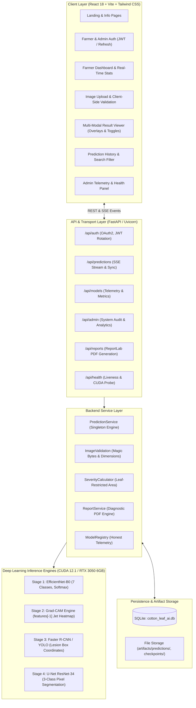
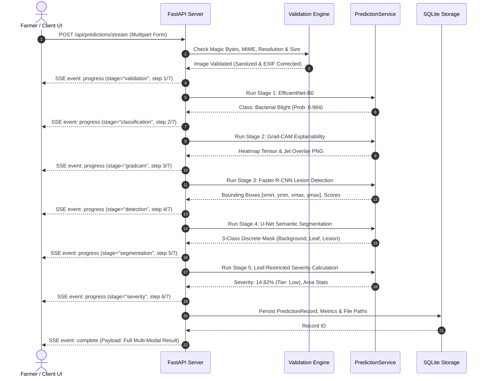

# CottonGuard AI — System Architecture & Inference Pipeline

**Document ID:** `reports/project_review/01_system_architecture_and_pipeline.md`  
**Project:** CottonGuard AI (`cotton_leaf_ai`)  
**Scope:** Final-Year Engineering Project Technical Architecture Specification  
**Status:** Complete & Verified  

---

## 1. High-Level System Architecture

CottonGuard AI is structured as an enterprise-grade, asynchronous multi-tier AI platform designed for automated cotton leaf health monitoring, disease diagnosis, lesion localization, tissue segmentation, and leaf-restricted severity estimation.

---

## 2. Multi-Stage AI Inference Pipeline

When a user submits a cotton leaf photograph, the system executes an orchestration pipeline comprising 7 discrete, fault-isolated stages.

---

## 3. Mathematical Severity Formulation

Standard naive segmentation models compute disease ratio relative to the full rectangular camera frame, introducing extreme bias when the leaf occupies only a fraction of the viewfinder. 

CottonGuard AI implements **Leaf-Restricted Severity Calculation**:

$$\text{Severity Percentage} = \frac{\text{Diseased Tissue Pixels}}{\text{Healthy Leaf Pixels} + \text{Diseased Tissue Pixels}} \times 100\%$$

Formulated in continuous set-theoretic terms:

$$\text{Severity} = 100 \times \frac{|\mathcal{M}_{\text{diseased}} \cap \mathcal{M}_{\text{leaf}}|}{|\mathcal{M}_{\text{leaf}}|}$$

Where:
- $\mathcal{M}_{\text{background}} = \text{Class 0}$ (Strictly excluded from denominator)
- $\mathcal{M}_{\text{healthy}} = \text{Class 1}$
- $\mathcal{M}_{\text{diseased}} = \text{Class 2}$
- $\mathcal{M}_{\text{leaf}} = \mathcal{M}_{\text{healthy}} \cup \mathcal{M}_{\text{diseased}}$

### Six-Tier Severity Schema
1. **Healthy:** $0.0\%$ affected
2. **Very Low:** $0.0\% < \text{Severity} \le 5.0\%$
3. **Low:** $5.0\% < \text{Severity} \le 15.0\%$
4. **Moderate:** $15.0\% < \text{Severity} \le 30.0\%$
5. **High:** $30.0\% < \text{Severity} \le 50.0\%$
6. **Severe:** $\text{Severity} > 50.0\%$

---

## 4. Hardware Optimization & Memory Management

- **Primary Target:** NVIDIA GeForce RTX 3050 Laptop GPU (6 GB VRAM).
- **Execution Mode:** Mixed-precision FP16 evaluation on CUDA `cuda:0`.
- **Dynamic Failover:**
  - If CUDA Out-Of-Memory (OOM) occurs, the `PredictionService` catches `torch.cuda.OutOfMemoryError`.
  - Clears CUDA cache (`torch.cuda.empty_cache()`).
  - Automatically switches the execution device to CPU (`torch.device('cpu')`), ensuring zero server crashes during high concurrency.
- **Model Lifecycle:** Singleton pattern loads models once during module initialization, preventing costly per-request re-initialization (saving ~35 seconds per request).
