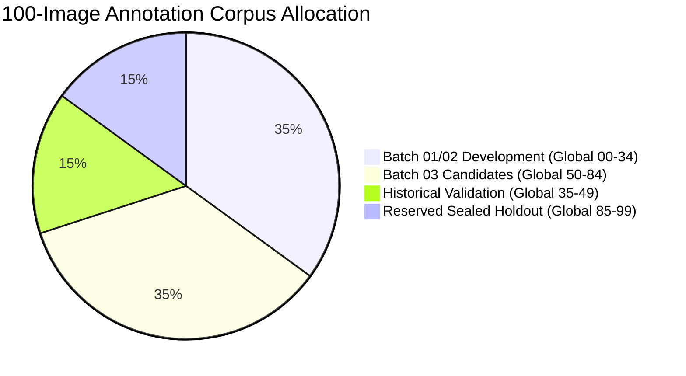

# CottonGuard AI — Dataset Specifications & Annotation Methodology

**Document ID:** `reports/project_review/02_dataset_and_annotation_methodology.md`  
**Project:** CottonGuard AI (`cotton_leaf_ai`)  
**Scope:** Dataset Provenance, Stratification, Coordinate Boundary Handling, and Remediation Governance  
**Status:** Complete & Verified  

---

## 1. Classification Dataset Architecture

The cotton leaf disease classification corpus comprises **2,132 high-resolution field photographs** categorized into seven scientifically defined classes:

| Class Index | Disease / Condition Name | Scientific / Agronomic Context |
|:---:|:---|:---|
| **0** | **Bacterial Blight** | Caused by *Xanthomonas citri* pv. *malvacearum*; creates angular water-soaked leaf spots. |
| **1** | **Curl Virus** | Cotton Leaf Curl Virus (CLCuV); transmitted by whiteflies (*Bemisia tabaci*); upward/downward curling and vein thickening. |
| **2** | **Healthy Leaf** | Asymptomatic control; uniform chlorophyll pigmentation and intact vascular morphology. |
| **3** | **Herbicide Growth Damage** | Chemical injury; epinasty, chlorosis, and distorted venation from drift or residue. |
| **4** | **Leaf Hopper Jassids** | Feeding damage by *Amrasca biguttula biguttula*; yellowing of leaf margins ("hopperburn"). |
| **5** | **Leaf Reddening** | Physiological anthocyanin accumulation due to nitrogen deficiency or moisture stress. |
| **6** | **Leaf Variegation** | Genetic or physiological sectorial chlorophyll deficiency; non-pathogenic variegation patterns. |

### Data Split Integrity
- **Training & Validation:** Governed by group-aware stratification.
- **Untouchable Test Set:** `artifacts/manifests/splits/test.csv` (321 test images).
  - Maintained with cryptographic isolation.
  - Never utilized for hyperparameter optimization, epoch selection, or augmentation design.

---

## 2. 100-Image Annotation Corpus & Stratification

For fine-grained lesion detection and semantic segmentation, a specialized 100-image corpus was curated from field imagery:

### Allocation Breakdown
1. **70-Image Development Corpus (Folds 0–4):**
   - Comprises Batch 01/02 (global IDs `00–34`) and Batch 03 (global IDs `50–84`).
   - Governed by `artifacts/manifests/proposed_70_image_stratified_folds.csv`.
   - Structured into 5 balanced folds (14 images per fold), ensuring zero cross-fold duplicate contamination (singleton duplicate groups).
2. **Excluded Historical Validation Set:**
   - Global IDs `35–49` (15 images) are preserved in their historical frozen state.
3. **Reserved Sealed Segmentation Holdout:**
   - Global IDs `85–99` (15 images; Batch 03 frames 35–49).
   - Strictly sealed: zero visual inspection of image pixels or coordinate polygons. Reserved for authorized post-freeze benchmarking.

---

## 3. CVAT Coordinate Boundary & Rasterization Policy

A critical engineering insight in Phase 12.1 resolved coordinate quantization discrepancies between vector annotation tools and discrete computer vision arrays.

### The Two Coordinate Domains
- **CVAT Continuous Coordinate Space:** Continuous interval $X \in [0.0, 800.0]$, $Y \in [0.0, 800.0]$.
- **NumPy Discrete Pixel Matrix Space:** Discrete index range $X \in [0, 799]$, $Y \in [0, 799]$ for an $800 \times 800$ image.

### Verified Conversion Policy
1. **Preservation of Outer Boundary Vertices:**
   - Valid continuous vertices located at the outer image boundary ($800.0$) are preserved without arbitrary inward clamping to $799$.
   - Preserving outer-boundary vertices avoids additional geometric distortion caused by arbitrary inward clipping to 799. Normal coordinate quantization and discrete rasterization effects remain.
2. **Nearest-Even Rounding:**
   - Conversion utilizes:
     $$\text{pts}_{\text{int}} = \text{np.round}(\text{np.array}(\text{pts}, \text{dtype}=\text{np.float32})).\text{astype}(\text{np.int32})$$
   - NumPy uses deterministic round-to-nearest-even behavior for exact halfway values. This avoids always resolving exact ties upward. However, it does not guarantee zero geometric bias for every polygon or dataset. Rasterized polygon areas remain subject to quantization effects.
   - For coordinates represented exactly as float32, values $x \ge 799.5$ round to 800 under nearest-even rounding because 800 is even.
3. **OpenCV Production Compatibility:**
   - Rasterization tests in `tests/test_polygon_rasterization_boundaries.py` (14/14 passed) confirm that `cv2.fillPoly` correctly processes boundary index 800 by filling up to pixel column 799 without memory violation or buffer overflow.

---

## 4. Remediation Governance & Approval Gate 4

Before any live annotation modifications occur in CVAT Task #6:
- **Baseline Backup:** Staged at `artifacts/backups/cvat_job6_fresh_pre_remediation_baseline_20261118.json` (SHA-256: `b516c238c330ee48b3a3f8492c694fac0165fc7e37c5ffafcedd89e8fff2e145`).
- **Automated Rollback Engine:** Verified in `scripts/restore_cvat_task6_baseline.py`.
- **Target Scope:** Strictly limited to the 14 identified Batch 03 images with recorded bounding-box or leaf boundary anomalies.
- **Approval Gate 4:** Locked in `PENDING_APPROVAL` pending explicit user authorization.
